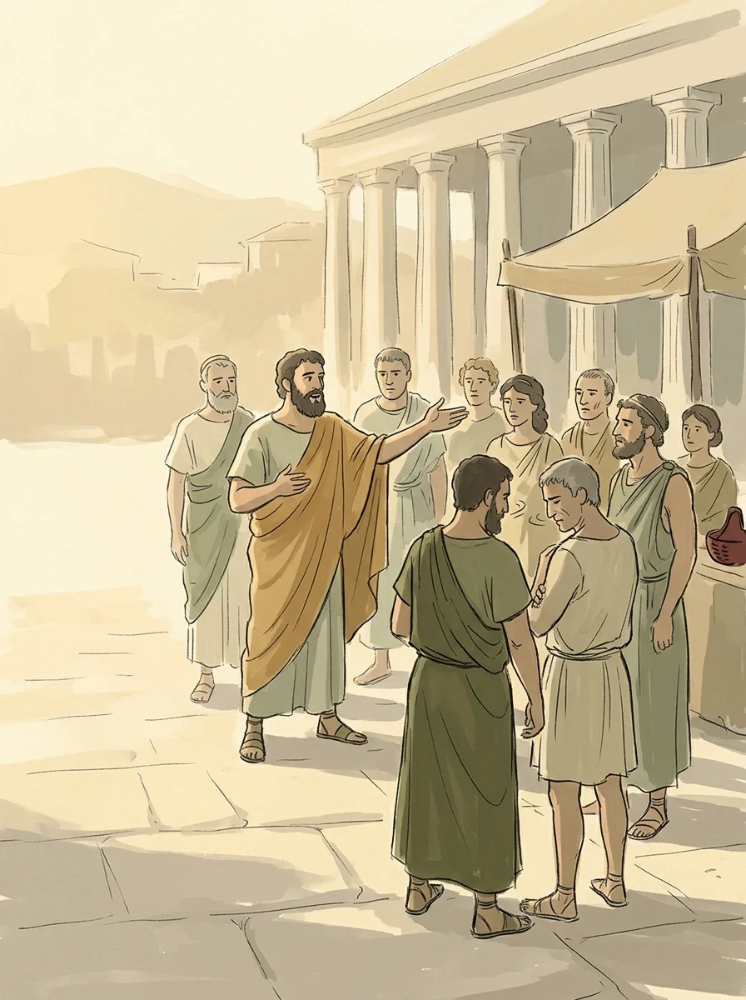

公元前八世纪到前二世纪之间，几个互不相识的文明几乎同时开始追问世界和人生的根本问题。德国哲学家雅斯贝尔斯把这段时间叫作“轴心时代”。我对东方的历史和思想更熟一些，所以这次先从相对陌生的希腊说起，再回头看看同一时期的中国、印度和埃及各自在想什么。

这是一个系列的第一篇，以后想到哪里，就接着写到哪里。

## 从“谁在操纵”到“是什么在运作”

在这之前，希腊人解释世界靠神话：打雷是宙斯发怒，海啸是波塞冬作怪。转折发生在公元前六世纪的米利都，一座位于今天土耳其西海岸的希腊城邦。

- **泰勒斯**说，万物的本原是水。
- **阿那克西曼德**是他的学生，却不买账。他认为任何一种具体的物质都解释不了所有东西，于是提出“无定”，一种没有固定形态的原始基质。
- **阿那克西美尼**又把它拉回具体物质：万物来自空气，空气浓缩成水和土，稀释成火。
- **赫拉克利特**跳出了“哪种物质”的争论。他说万物都在流动，火是变化的象征，但变化背后有一套永恒的理性法则，他称之为 Logos。

这些答案今天看来都很朴素，重要的是问法变了：从“是谁在操纵世界”，变成“世界是靠什么在运作”。这一步，给后来的科学和哲学铺了路。

需要说明的是，这并不是一夜之间抛弃宗教。据亚里士多德记载，泰勒斯也说过“万物充满了神”。理性是从神话里一点点长出来的，并不是把神话一刀切掉。

## 我的第一个猜想：地理

为什么偏偏是希腊？我最初的猜想是地理。希腊多山，土地贫瘠，三面环海，生活条件苛刻。神迟迟不出现，人最终只能靠自己，所以他们思考的是人与自然的关系。

后来查了一些资料，发现这个解释只对了一半。地理确实逼着希腊人走向海洋，也让他们分成许多独立的城邦，没能形成一个大帝国。但真正把这些条件变成哲学的，还有两样东西：

- **贸易带来的怀疑**：米利都是当时的贸易枢纽。希腊人从埃及学几何，从巴比伦学天文，也发现不同民族对神和世界的解释完全不同。当你意识到邻居的世界观和你的神话互不兼容，传统权威就不再是绝对的了。人们需要一种谁都能检验的解释工具，也就是逻辑。
- **城邦广场上的辩论**：城邦的公共事务在广场上公开讨论，靠说服而不是靠神谕。这种习惯被带进了对自然的探讨：任何关于宇宙的理论，都得经得起当众辩驳。

所以我现在的看法是：地理提供了舞台，贸易和辩论才是演员。另外，“生存危机催生哲学”这个说法也不太能套用到东方。春秋时期礼崩乐坏，更像是秩序的危机，谈不上活不下去。

## 希腊这条线：从琢磨水到琢磨逻辑

米利都学派之后，希腊哲学像一场接力：

- **苏格拉底**把目光从自然转向人，追问什么是正义，什么是美德。
- **柏拉图**把这推到顶点，认为我们看到的现实只是更高层次的“理念”的投影。
- **亚里士多德**把前人的东西系统化，建立了一套严密的逻辑学。

从泰勒斯到亚里士多德，两百多年，希腊人从琢磨水，走到了琢磨思维本身的规则。

## 同一时代，四种问题

把视线拉开，同一时期的几个文明各问各的问题：

- **希腊向外看**：客观世界由什么构成，人该用什么方法去推理。
- **中国看人与社会**：老子、孔子大致在这个时期（老子的年代学界还有争议）。他们关心人在社会中的位置，是该顺应自然，还是遵循礼法。
- **印度向内看**：早期的奥义书正在成形，比如《广林奥义书》和《歌者奥义书》。核心问题是个体灵魂与宇宙终极实在的关系，也就是“梵我合一”。他们相信，看透了这一点，就能从痛苦中解脱。
- **埃及守护秩序**：此时的埃及已是古老文明的晚期，没有思想上的剧变，而是在维护一种叫“玛阿特”的宇宙秩序。

一个向外探索，一个安顿人伦，一个向内求索，一个守住平衡。至于为什么会同时发生，我想不出答案，大概到今天也没有定论。我更感兴趣的是它们各自在想什么。

下一篇，从印度说起：思考得这么深，动力到底从哪里来。
