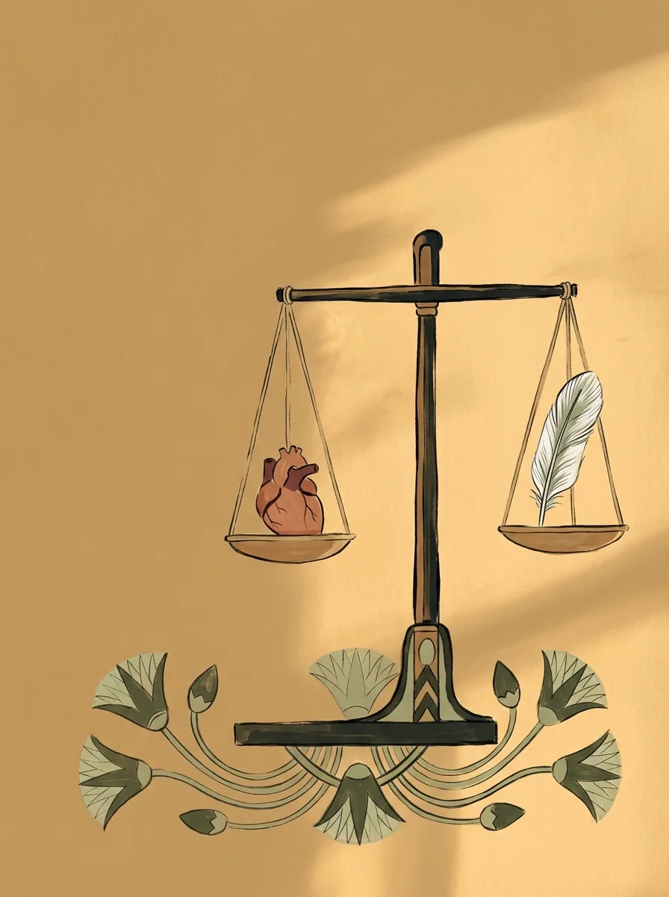
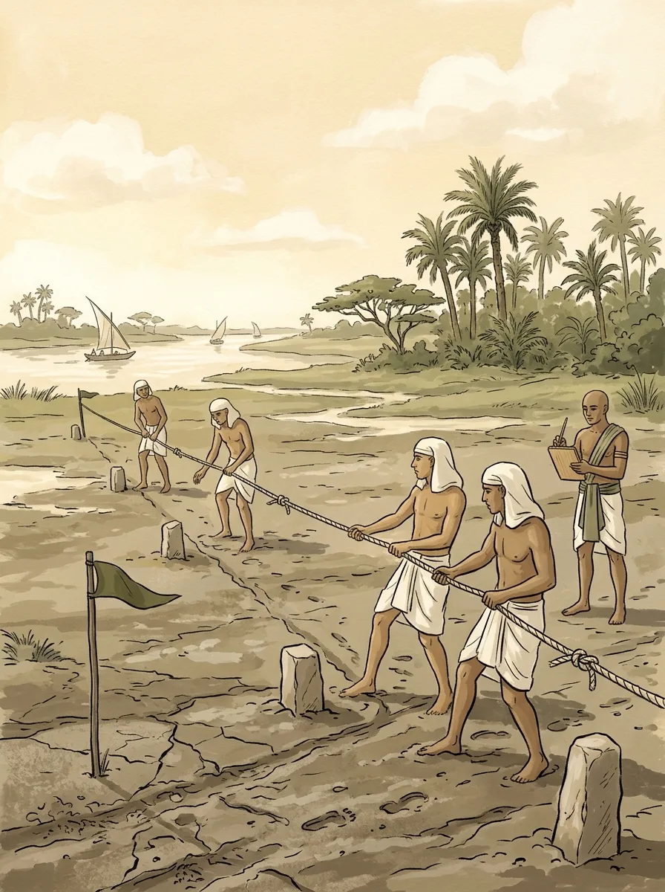

While the Greeks were arguing over what everything is made of, and the Indians were asking about Brahman and the self, Egypt already had more than two thousand years of history behind it. In the sixth century BCE it was an ancient civilization in its late stage, and no great intellectual upheaval was underway. The Egyptians were busy with something else: keeping an order intact. That order was called Ma'at.

## Ma'at, in Plain Terms

Ma'at is usually translated as truth, justice or cosmic order, all of which sound rather abstract. Put simply, the Egyptians believed the universe has a right way of running, and that everything in it has its proper place. As long as nobody upsets that balance, the world runs smoothly.

In everyday life, that meant not lying and not bullying others, because every unjust act tips the scales.

## The Heart and the Feather

Nothing captures Ma'at better than the judgment the Egyptians imagined waiting for them after death.

The dead person's heart was placed in one pan of a scale, and in the other a feather, the symbol of Ma'at. If the two balanced, the dead could pass on to eternal life. If the heart was weighed down by wrongdoing, a monster devoured it.

Notice that the test is balance, not "the lighter the better." That one detail says a great deal about how the Egyptians thought.

## What the Nile Taught Them

I kept wondering why the Egyptians cared so much about balance. The answer very likely lies in the Nile.

The river flooded every year, on schedule, leaving behind rich silt. Too little water meant famine; too much washed villages away. What the Egyptians hoped for was neither too much nor too little. They even built "Nilometers" just to measure the height of the water. You could say the river carved the pursuit of balance into their bones.

There's another detail I love. Every time the floodwaters went down, the boundaries between fields had been wiped away, and surveyors had to measure the land all over again with knotted ropes. The Greeks later called them "rope-stretchers." Herodotus believed that geometry itself began with this Egyptian need to divide up the land again.

To the Egyptians, geometry wasn't just a field of knowledge; it was a way of winning order back from chaos. Weighing a heart on a scale and measuring fields after a flood follow the same logic: hold chaos at bay with an objective standard.

## What's Left Today

Apart from people of faith, modern people seem barely touched by these ancient ideas. The stories could never be verified, and so, gradually, people stopped believing them.

But one thing survived in a new form: the idea of judging right and wrong by an objective standard. Modern courts pursue fairness by weighing the evidence on both sides, and Lady Justice still holds a pair of scales. That isn't necessarily an Egyptian belief handed down intact. It looks more like different peoples arriving at the same answer when faced with the question of what fairness is.

Next time, we jump ahead two hundred years: Alexander marches east, China enters the Warring States period, and several civilizations once again turn the same corner without ever comparing notes.
