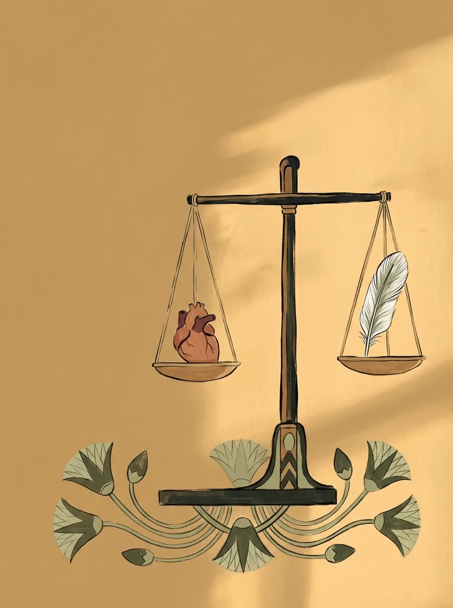
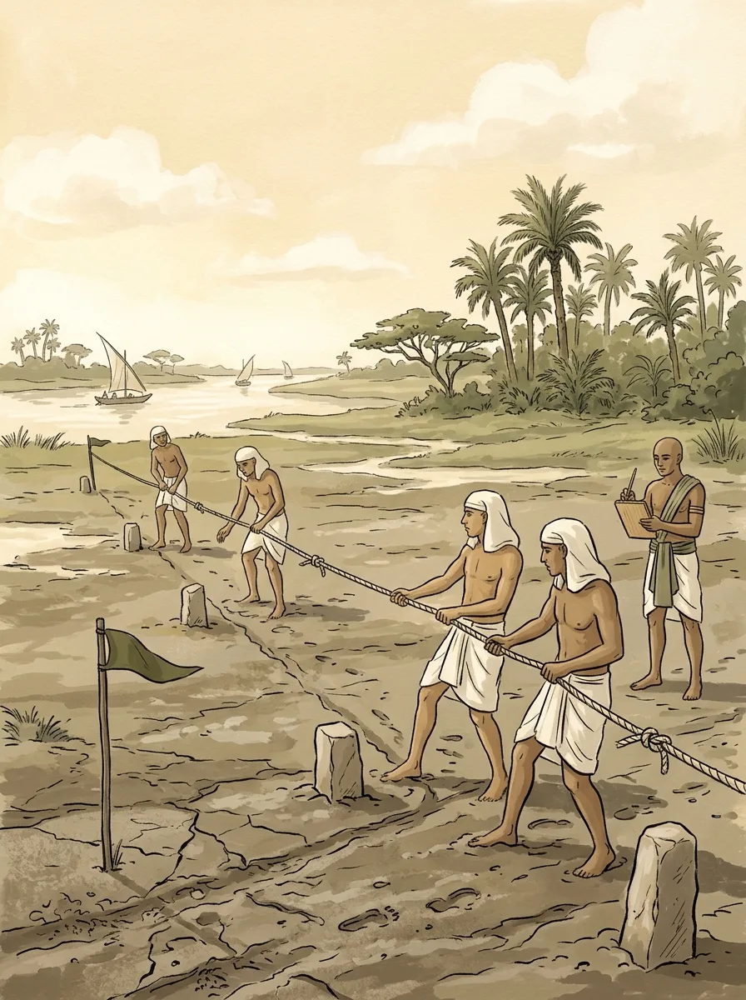

当希腊人在争论万物的本原、印度人在追问梵与我的时候，埃及已经走过了两千多年的历史。公元前六世纪，它处在古老文明的晚期，没有发生什么思想上的剧变。埃及人在做另一件事：守住一种秩序。这种秩序叫“玛阿特”（Ma'at）。

## 说白了，玛阿特是什么

玛阿特通常被翻译成真理、正义、宇宙秩序，听起来很抽象。说得通俗一点：埃及人认为宇宙有一套“正确的运行方式”，每样东西都有它该在的位置。只要不去破坏这个平衡，世界就能顺畅运转。

落到日常生活里，就是不撒谎，不欺压别人，因为任何不义的行为都会让天平倾斜。

## 心脏和羽毛

最能说明玛阿特的，是埃及人想象中的死后审判。

死者的心脏被放在天平一端，另一端是象征玛阿特的羽毛。两边平衡，死者才能进入永生；心脏如果被罪孽压得太重，就会被一头怪兽吞掉。

注意，标准是平衡，并不是越轻越好。这个细节很能说明埃及人的思路。

## 尼罗河教会他们的事

我一直在想，埃及人为什么这么看重平衡。答案很可能就在尼罗河。

尼罗河每年定期泛滥，带来肥沃的淤泥。水太少会闹饥荒，水太多会冲毁村庄，埃及人盼的是不多不少。他们甚至修了专门测量水位的“尼罗尺”。追求平衡，几乎是这条河刻进他们骨子里的。

还有一个细节很有意思。每次洪水退去，田地的边界都被冲没了，需要专门的测量员拿着打结的绳子重新丈量土地，后来的希腊人管他们叫“拉绳者”。希罗多德认为，几何学就起源于埃及人这种重新划分土地的需要。

在埃及人眼里，几何不只是一门学问，也是从混乱中夺回秩序的手段。天平上称心脏，洪水后量土地，其实是同一个逻辑：用一个客观标准，对抗混乱。

## 今天还剩下什么

除了有宗教信仰的人，现代人好像很少再受这些古老观念影响。那些故事始终无法验证，人们也就渐渐不再相信。

不过有一样东西换了个形式留了下来：用客观标准判断对错的思路。现代法庭追求公正，把双方的证据放在一起称量，正义女神手里也拿着天平。这未必是埃及信仰一路传下来的，更像是人类面对“什么是公正”时殊途同归的答案。

下一篇，时间往后推两百年：亚历山大东征，中国进入战国，几个文明又不约而同地转了个弯。
