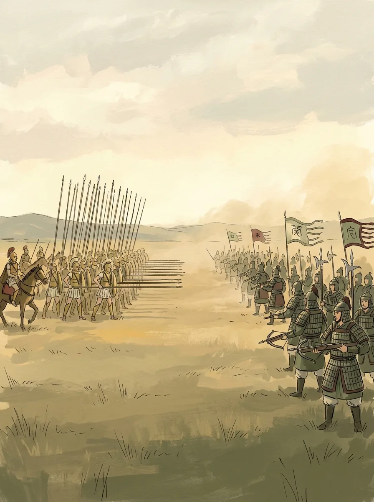

We're now in the late fourth century BCE. Greece is in the last glow of its brilliance, and Alexander of Macedon has fought his way to the banks of the Indus; China, meanwhile, is in the middle of the Warring States period. This essay covers three things: what people of this era were thinking about, where Alexander went to school and why he went to war, and what might have happened had he run into the great generals of the Warring States.

## Turning the Same Corner

Alexander was Aristotle's pupil and studied with him for a few years as a teenager. After Alexander's death, the Greek world entered what we call the Hellenistic Age. Curiously, several civilizations at this point shifted their gaze, almost in unison, from "what is the cosmos?" to "how does a person get through life?"

- **Greece**: around 300 BCE, two schools of thought came to dominate. The Stoics taught that you should focus on what you can control and calmly accept what you can't; the Epicureans held that the best life is one free of fear and pain, simple and serene.
- **India**: Ashoka of the Maurya dynasty turned to Buddhism after a bloody war of conquest, and Buddhism went from a private path of renunciation to a state-backed teaching that spread outward.
- **Egypt**: it became the realm of the Ptolemaic dynasty, founded by one of Alexander's generals. The Library of Alexandria became the intellectual center of its day, and Euclid worked there.

Grand theories of the cosmos retreated into the background, and what came to the fore was one survival guide after another. The more chaotic the times, the more people need to know how to live.

## The School at Mieza

Alexander studied with Aristotle at Mieza, in Macedonia, and in recent years archaeologists there have kept turning up more. Kottaridi, the archaeologist leading the excavation, believes the site was an entire royal gymnasium built to a single design, completed in 343 BCE, the very year Aristotle arrived. Among the finds:

- **four bronze styluses**, quite possibly used by the students;
- **a two-story covered running track nearly 200 meters long**, along with a lecture hall;
- **two banquet halls with mosaic floors**, each seating at least twenty people.

Why did Aristotle end up in Macedonia at all? He spent twenty years at Plato's Academy but didn't get to take it over, so he went off to the island of Lesbos to dissect sea creatures, and only later was invited by Philip II to teach his son.

More intriguing still, Ptolemy, who went on to found the Ptolemaic dynasty in Egypt, was also a student here. Kottaridi believes the Library of Alexandria that Ptolemy later built was modeled on Mieza. One school, with Aristotle at one end and the Library of Alexandria at the other. (Source: [National Geographic, October 30, 2026](https://www.nationalgeographic.com/newsletters/article/aristotle-gymnasium-alexander-the-great-stones-and-bones))

## Why Would a Student of Logic Go to War?

This is the part I can't make sense of. Alexander studied logic with Aristotle, then spent his life on campaign, while countless people were driven from their homes and their families destroyed. What kind of logic was that, from where he stood?

My reading is that the logic Aristotle taught was a set of tools for classifying, defining and reasoning. It could help Alexander plan supply lines and read terrain, but it could never give the people who lost their homes a reason that made sense. However efficient the war, its efficiency doesn't cancel out the suffering it caused.

So what drove the campaign east? My first guess was that Macedonia was in desperate straits, the way some modern states, when the pressure at home gets too high, start a war abroad to change the subject.

The sources say otherwise. Macedonia was a rising power. The invasion of Persia had been set up long before by his father, Philip II: the army was trained, the plans were drawn up, and the whole enterprise flew the banner of avenging Greece for a Persian wrong more than a century old. What Alexander inherited was a war machine with its engine already running.

## Two Kinds of Desire

What separates expansion for the sake of power from a war fought to survive by deflecting trouble at home? I think both are desire; they just have different centers of gravity.

In terms of Maslow's hierarchy of needs, expansion for power is about achievement, at the top of the pyramid, while desire born of not being able to survive is the most basic need, at the very bottom. They start from completely different places.

But here you have to ask: whose survival? A war a ruler wages to hang on to his throne is still the appetite for power at the top of the pyramid, and it shouldn't be lumped together with ordinary people's need to stay alive. Otherwise, expansion for power can all too easily be dressed up as a kind of survival instinct.

## If Alexander Met the Generals of the Warring States

Finally, a purely imaginary question: if great generals like Wang Jian, Li Mu or Bai Qi led the finest troops of the Warring States against Alexander, who would win?

Start with the equipment:

- **Alexander**: at the core, the Macedonian phalanx, infantry carrying sarissas more than five meters long, all but unstoppable when advancing head-on; alongside it, the Companion cavalry striking from the flank. One is the anvil, the other the hammer.
- **The Warring States armies**: mass-conscripted infantry with mass-produced crossbows fitted with bronze trigger mechanisms, plus dagger-axes, halberds, and leather or iron armor.

It's the classic matchup of offense against defense. On an open plain, if the phalanx could push through the crossbow volleys and close in, its pikes could tear the enemy line apart, and the cavalry charge would be a serious threat. But in the mountains, or on the defensive, the Warring States armies' firepower at range and their sheer staying power would make life very hard for the Greeks.

What's more, a general like Li Mu would never fight at the distance his opponent liked best. Against the Xiongnu horsemen on the northern frontier, he first feigned weakness to lure them deep, then closed in from both flanks and routed them in a single battle. As it happens, Alexander also fought steppe cavalry. Both men had faced opponents who didn't play by the usual rules.

So my conclusion is this: the outcome would turn on terrain and command, and neither side's equipment guarantees a win.

What really keeps me thinking is a different question: in a contest like this, where would the decisive moment come? I haven't worked it out yet. What do you think?

This series will continue.
