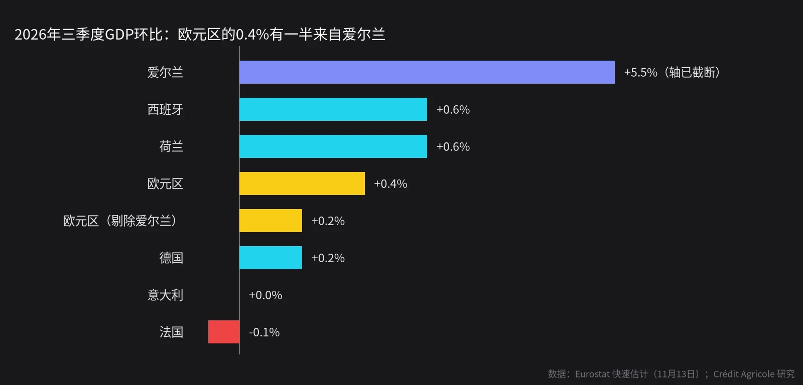

先给答案：**西班牙人德科斯（Pablo Hernández de Cos）大概率成为下一任欧央行行长，拍板时间最可能是12月17–18日的欧盟峰会。** 但这不是一场单纯的"二选一"，而是法国和德国在分三个位子。

## 一、为什么突然要换帅

10月29日，拉加德宣布将在**2027年2月7日**卸任，比八年任期（到2027年10月底）提前约九个月。她给的理由很直白：央行行长必须政治中立，而她"不能再保持中立"，想要"发表意见的自由"。外界普遍把这和明年春天的法国总统选举联系起来，她本人则说"我不是任何职位的候选人"。

巧的是，执行委员会另外两个人也要走：

- **施纳贝尔（Isabel Schnabel，德国）**，主管市场操作，1月3日离任去国际货币基金组织；
- **连恩（Philip Lane，爱尔兰）**，首席经济学家，任期5月底结束。

六人执行委员会，五个月内走掉三个。欧元集团主席皮埃拉卡基斯已经明说：三个位子很可能打包一起定。

## 二、两位候选人

11月6日提名截止，只有两人：

- **德科斯（西班牙）**：2018–2024年任西班牙央行行长，2025年7月起任国际清算银行（BIS）总经理。风格偏温和，善于搭共识。若当选，将是第一位西班牙籍欧央行行长。
- **克诺特（Klaas Knot，荷兰）**：2011–2025年任荷兰央行行长，长期是管理委员会里的"鹰派"代表。

两人都是老央行人，市场不必担心"外行上任"。差别在于取向：德科斯对财政吃紧的南欧更友好，克诺特更强调控通胀。

## 三、真正的牌桌：法德交易

据《国家报》和《商报》报道，法德正在谈的方案是：

- **行长给德科斯**——法国支持他；
- **首席经济学家给德国**——默茨属意普林斯顿大学的布伦纳迈尔（Markus Brunnermeier）。若成，这将是2011年施塔克（Jürgen Stark）离任后第一位德国籍首席经济学家；
- **施纳贝尔的市场操作席位给法国**。

如果反过来克诺特当选，则首席经济学家归法国、德国保住市场操作席位。不论哪种，**两个副手位子大概率落在法德手里**。

默茨11月13日在都柏林说"协议在望，但还没定"，需要几天和联合执政伙伴商量。时间表上：另两个职位的提名截止是**11月18日**；科斯塔计划在**11月26日**峰会开始征询欧洲议会和欧央行管理委员会；最终拍板瞄准**12月17–18日**峰会。

## 四、新行长接手一个什么样的欧元区

- **通胀**：10月初值**4.0%**，是目标的两倍，主因是中东冲突推高能源价格；剔除能源后为2.3%。
- **利率**：存款利率目前**2.5%**，10月29日按兵不动。路透11月12日调查显示，多数经济学家认为**12月17日会再加息一次**；德国央行行长纳格尔11月13日说，形势不变的话"很可能还得再行动"。

- **增长**：三季度GDP环比**+0.4%**，看着不错，但其中约0.2个百分点来自爱尔兰（环比+5.5%）。剔除爱尔兰只有0.2%；法国**−0.1%**，意大利**0**，西班牙**+0.6%**一枝独秀。就业环比持平。

换句话说，新行长将在"通胀高、增长靠边缘国家撑"的局面下接手，而且首先要面对的很可能是**何时停止加息**这个问题。德科斯若上任，市场大概会把他理解为"更早收手"的信号。

## 五、我猜

| 预测 | 概率 | 检验时间 |
|---|---|---|
| 欧盟领导人在12月17–18日峰会上任命新行长 | 70% | 2026-12-18 |
| 新行长是德科斯（此前看板写60%，现上调） | 70% | 2026-12-31 |
| 执行委员会三个空缺中，德、法各拿一席 | 80% | 2026-12-31 |
| 布伦纳迈尔被定为下任首席经济学家 | 45% | 2026-12-31 |
| 欧央行12月17日加息25个基点 | 85% | 2026-12-17 |

最后一条看板上已有，这里只是重申。结果到期后会在首页「我猜」看板对账。

**图片**：封面为法兰克福美因河畔的欧央行总部（Dr. Thomas Liptak 摄，CC BY-SA 4.0，经 Wikimedia Commons）；增长图为本站自制。

*资料来源：欧央行、欧元集团声明，Euronews、路透、Politico、Eurostat、Crédit Agricole 研究，截至2026年11月15日。*
