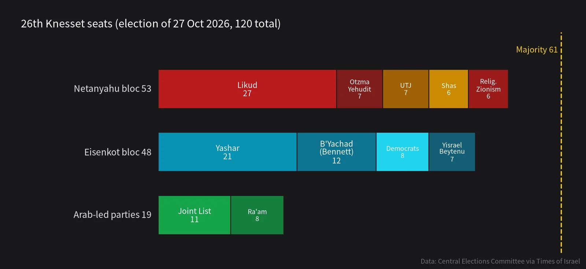

The short answer: **the far right's era in government is probably ending. Its era of shaping the agenda is not.**

Itamar Ben-Gvir and Bezalel Smotrich will very likely lose their ministries in the coming months. But Netanyahu's likely successor heads a centre-right coalition led by a former army chief. Its quarrel with Netanyahu is mostly about how to fight and who is accountable, not about whether Palestinians should have a state.

Below I set out the result, then my forecasts. Each one has a probability and a date you can check, a month or a year from now.

## 1. The result: nobody has a majority

On 27 October Israel elected its 26th Knesset (120 seats). Turnout was 77.9%, about seven points higher than in 2022.

- **Netanyahu's bloc, 53 seats**: Likud 27, Otzma Yehudit (Ben-Gvir) 7, United Torah Judaism 7, Shas 6, Religious Zionism (Smotrich) 6.
- **Eisenkot's bloc, 48 seats**: Yashar 21, Naftali Bennett's B'Yachad 12, the Democrats 8, Avigdor Liberman's Yisrael Beytenu 7.
- **Arab-led parties, 19 seats**: Joint List 11, Ra'am 8, a record.

A few details matter:

1. **The far-right vote did not collapse.** Otzma Yehudit and Religious Zionism hold 13 seats together, close to the 14 their joint list won last time. They lost the coalition arithmetic, not their voters.
2. **Arab voters decided it.** A surge in Arab turnout pushed the two Arab-led parties to 19 seats and kept Netanyahu's bloc short of 61.
3. **The ultra-Orthodox are wavering.** United Torah Judaism (7 seats) refused to recommend anyone, over the dispute on military-service exemptions for yeshiva students. Shas leader Aryeh Deri has reportedly withdrawn from the party's list.

## 2. Where things stand

- On 8 November President Isaac Herzog gave the mandate to **Gadi Eisenkot**. He was recommended by 67 MKs (48 from Jewish opposition parties plus 19 from Arab-led parties); Netanyahu got 46.
- Eisenkot has **28 days**, extendable by up to 14, so until about **6 December**, and at the latest around **20 December**.
- If he fails, the president can name someone else (28 days), and there is a final parliamentary round (21 plus 14 days). After that the Knesset dissolves and a new election follows within 90 days.
- The catch: 67 recommendations are not 67 MKs willing to govern together. Liberman refuses to rely on Arab parties; Bennett is further right than in 2021; the Joint List declined Eisenkot's demand to call Hamas a terrorist organisation that must be destroyed.
- Eisenkot has four routes: (1) outside support from Arab parties; (2) bring in the ultra-Orthodox (Shas plus UTJ is exactly 13, and 48 plus 13 is exactly 61); (3) a unity government with Likud; (4) peel off defectors from the other side.

## 3. Would a new government be different?

At home, yes. The opposition agrees on a state commission of inquiry into 7 October, ending the judicial overhaul, repairing the civil service and passing a budget.

On the Palestinian question, the gap is much smaller than the headline suggests. Eisenkot is closely associated with the "Dahiya doctrine" of overwhelming force against areas hostile groups operate from, and his son was killed in Gaza. Yashar's platform does not clearly endorse a Palestinian state. Bennett wants troops to stay on Gaza's "Yellow Line" until Hamas disarms. Liberman wants to dismantle the Palestinian Authority and annex Area C. Only the Democrats back two states.

So the more accurate framing is: **Israel would move from a far-right government to a right-leaning centrist one.** The tone changes, relations with Washington change, some policies loosen. The steering wheel does not turn around.

. Image: Ashraf Amra, CC BY-SA 3.0 IGO, via Wikimedia Commons")

## 4. My forecasts (as of 10 November 2026)

### 1. Coalition

| Outcome | Probability |
|---|---|
| Eisenkot becomes prime minister by end of January 2027 | **60%** |
| — via the ultra-Orthodox joining | 35% |
| — via outside support from Ra'am and other Arab parties | 20% |
| — via a coalition with a post-Netanyahu Likud | 5% |
| Coalition talks fail; new election in spring 2027 | 30% |
| Netanyahu forms a new government | 10% |

My reasoning: what the ultra-Orthodox care about most is the draft exemption and budgets, not who is prime minister. Once Eisenkot offers a "gradual conscription" formula they can sell to their voters, Shas and UTJ are the likeliest to switch. He would be accused of breaking a campaign promise, but he would get the premiership. **The signal to watch: whether UTJ signs a draft compromise by mid-December.**

One more risk deserves its own line. Netanyahu stays prime minister while caretaker. Former US ambassador Dan Shapiro suggests he may refuse compromises, resume military action against Iran during the formation period, and gamble on an election in about six months. That "run out the clock" path is included in the 30% above.

### 2. The far right

- **Neither Ben-Gvir nor Smotrich is a minister by June 2027: 75%.** Unless Netanyahu forms the next government, they are out.
- **But together they win at least 10 seats at the next election: 70%.** Their base, especially settlers and young religious voters, has not shrunk. Being out of power will make them more radical, not make them disappear.

### 3. Gaza

- **The IDF still controls most of Gaza, around the "Yellow Line", at the end of 2027: 80%.**
- **The International Stabilization Force deploys to at least one area of Gaza by mid-2027: 55%.** A new government would be more willing than Netanyahu to work with Trump's "second phase", because it hands the question of who governs Gaza to someone else.
- **Hamas completes verifiable, full disarmament by end of 2027: 10%.** This is the weakest link in the whole plan.
- Reconstruction will start, but as pilot zones in areas Hamas has left or been cleared from, not across the Strip.

### 4. The West Bank

- **Israel formally legislates annexation of any part of the West Bank in 2027: under 10%.** Annexation drops off the government's agenda.
- **But settler violence and settlement growth do not fall noticeably: 70%.** They run on local settler organisations, on-the-ground enforcement and years of budget momentum, which a change of government cannot reverse quickly.

### 5. The region

- **Saudi Arabia and Israel announce normalisation by end of 2027: 20%.** Talks would restart, but Riyadh wants a credible path to a Palestinian state, which is exactly what Eisenkot's coalition cannot offer.
- **An Israeli government accepts the principle of Palestinian statehood in 2027: under 5%.**

### 6. Netanyahu himself

- **If he loses office, Likud starts a leadership transition by end of 2027: 50%.** He is still on trial and faces an International Criminal Court arrest warrant. Out of office, talk of a plea deal in exchange for leaving politics will return.

## 5. In one line

**The far right will leave government, but not Israeli politics.** The next government would look like the 2021 Bennett-Lapid "change government": held together by opposition to Netanyahu, deliberately vague on the Palestinians. Last time that vagueness lasted a year. This time the Gaza ceasefire, Trump's pressure and the winter tent camps will not give it that long.

**The forecast I am most confident in:** whoever governs, Gaza's word for 2027 will be "limited international administration", not "peace" and not "all-out war".

**What could make me wrong across the board:** a major attack, or a renewed war with Iran, during coalition talks. A security crisis would push the whole political spectrum right once again.

---

**Dates to watch**

- **Around 6 December**: Eisenkot's 28-day deadline
- **Around 20 December**: latest deadline with extensions
- **Mid-December**: whether UTJ accepts a draft compromise
- **January 2027**: parliamentary nomination stage if both rounds fail
- **Spring 2027**: election window if no government forms

**Sources**: Times of Israel (29 October, final seats); AP (30 October); BBC (4 November); Al Jazeera (3 to 4 November); Anadolu Agency (9 November, formation rules); The Jerusalem Post live coverage (7 to 10 November); Arab News analysis (8 to 10 November); Axios via Arab News (9 November); UN OCHA (5 November).

**Images**: cover shows the Knesset building in Jerusalem (Flickr user, CC0); inline aerial of Rafah (Ashraf Amra, CC BY-SA 3.0 IGO), both via Wikimedia Commons; seat chart made for this blog.

*This is personal reasoning based on public reporting. The probabilities are subjective. Come back in a year and check them.*
