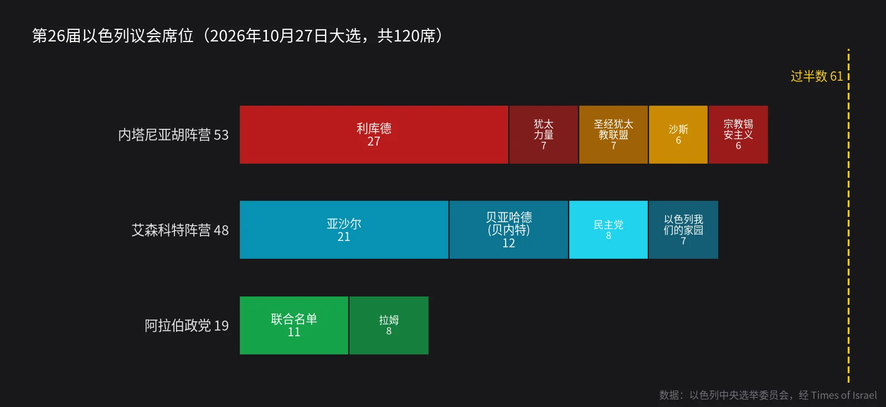
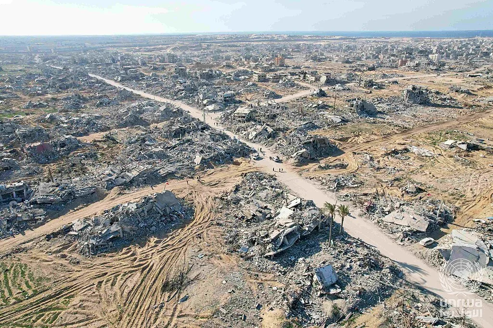

先给答案：**极右翼"执政"的时代，大概率要结束了；极右翼"塑造议程"的时代，还远没有结束。**

本-格维尔和斯莫特里奇很可能在未来几个月里失去部长职位。但接替内塔尼亚胡的，是一位前总参谋长领导的中右翼联盟，他们和前任的分歧主要在"怎么打、谁负责"，而不在"要不要给巴勒斯坦人一个国家"。

下面先讲清楚选举结果，再给出我的预测。每一条都标了概率和可检验的时间点，一个月后、一年后都可以回来对账。

## 一、选举结果：谁都没过半

10月27日，以色列选出第26届议会（共120席），投票率77.9%，比2022年高出约7个百分点。

- **内塔尼亚胡阵营 53 席**：利库德27、犹太力量（本-格维尔）7、圣经犹太教联盟7、沙斯6、宗教锡安主义（斯莫特里奇）6。
- **艾森科特阵营 48 席**：亚沙尔21、贝内特的贝亚哈德12、民主党8、利伯曼的以色列我们的家园7。
- **阿拉伯政党 19 席**：联合名单11、拉姆8，创历史纪录。

几个值得注意的细节：

1. **极右翼的票并没有崩。** 犹太力量加宗教锡安主义合计13席，和上届联合名单的14席相差无几。它们输掉的是"组阁数学"，不是选民。
2. **决定胜负的是阿拉伯选民。** 阿拉伯社区投票率大涨，把两个阿拉伯政党推到19席，直接让内塔尼亚胡阵营够不到61席。
3. **极端正统派动摇了。** 圣经犹太教联盟（7席）因为神学院学生服兵役豁免的争端，拒绝推荐任何人。据报道，沙斯领袖德里已退出党的议员名单。

## 二、现在走到哪一步

- 11月8日，总统赫尔佐格把组阁授权交给**加迪·艾森科特**。他获得67席推荐（48席犹太反对党加19席阿拉伯政党），内塔尼亚胡只有46席。
- 艾森科特有**28天**组阁，可再延长最多14天，也就是大约**12月6日**，最晚**12月20日**左右。
- 失败的话，总统可以再指定一人（28天），最后还有一轮议会提名（21天加14天）。再不行就解散议会，90天内重选。
- 关键问题是：推荐他的67席，并不等于愿意一起执政的67席。利伯曼拒绝依赖阿拉伯政党；贝内特比2021年更右；联合名单拒绝按艾森科特的要求称哈马斯为"必须消灭的恐怖组织"。
- 艾森科特的四条路：①拉阿拉伯政党"外部支持"；②拉回极端正统派（沙斯加圣经犹太教联盟正好13席，48加13刚好61）；③和利库德搞团结政府；④从对面"挖人"。

## 三、新政府会和内塔尼亚胡不同吗？

在国内事务上，会。反对党的共识很清楚：成立国家调查委员会追究10月7日的责任、停止司法改革、修复公务员体系、通过预算。

在巴勒斯坦问题上，差别比标题小得多。艾森科特是"达希耶主义"（对敌方活动区域使用压倒性武力）的代表人物之一，儿子在加沙阵亡。亚沙尔的纲领没有明确支持巴勒斯坦建国；贝内特要求部队守在加沙"黄线"直到哈马斯缴械；利伯曼要解散巴勒斯坦权力机构、吞并C区；只有民主党支持两国方案。

所以更准确的说法是：**以色列会从"极右翼政府"换成"右倾的中间派政府"。** 语气变了，和华盛顿的关系变了，部分政策会松动，但方向盘不会掉头。

## 四、我的预测（截至2026年11月10日）

### 1. 组阁

| 结果 | 概率 |
|---|---|
| 艾森科特在2027年1月底前出任总理 | **60%** |
| 　其中：靠极端正统派入阁 | 35% |
| 　其中：靠拉姆党等阿拉伯政党外部支持 | 20% |
| 　其中：与后内塔尼亚胡时代的利库德合组 | 5% |
| 组阁失败，2027年春季重选 | 30% |
| 内塔尼亚胡另行组成新政府 | 10% |

我的判断依据：极端正统派最在乎的是兵役豁免和预算，不是谁当总理。一旦艾森科特给出一个能对选民交代的"渐进征兵"方案，沙斯和圣经犹太教联盟最可能倒戈。这会让他背上"违背竞选承诺"的骂名，但能换来总理职位。**最值得盯的信号是：圣经犹太教联盟是否在12月中旬前签下兵役妥协。**

还有一个风险要单独提：看守期间内塔尼亚胡仍是总理。前美国驻以大使夏皮罗认为，他可能拒绝妥协、在组阁期间重启对伊朗的军事行动，赌半年后的重选。我给这种"拖到重选"路线的概率已经算在上面的30%里。

### 2. 极右翼

- **本-格维尔和斯莫特里奇在2027年6月前都不再担任部长：75%。** 只要不是内塔尼亚胡继续组阁，他们就出局。
- **但他们在下一次大选中的合计席位不会低于10席：70%。** 极右翼的选民基础，尤其是定居点和年轻宗教选民，并没有萎缩。出局会让他们更激进，而不是消失。

### 3. 加沙

- **以军在2027年底前仍控制加沙的大部分地区（守在"黄线"附近）：80%。**
- **国际稳定部队在2027年年中前进驻加沙至少一个区域：55%。** 新政府会比内塔尼亚胡更愿意配合特朗普的"第二阶段"，因为这能让它把"谁管加沙"的难题交给别人。
- **哈马斯在2027年底前完成可核查的全面缴械：10%。** 这是整个计划最弱的一环。
- 重建会开始，但以"试点区"的形式，从哈马斯已撤出或被清空的地区先行，而不是全面铺开。

### 4. 约旦河西岸

- **2027年内以色列正式立法吞并西岸任何区域：低于10%。** 吞并会从政府议程上消失。
- **但定居者暴力和定居点扩张不会明显减少：70%。** 这些事靠的是地方定居者组织、军方现场执法和多年的预算惯性，换一届政府很难立刻扭转。

### 5. 地区格局

- **沙特与以色列在2027年底前宣布关系正常化：20%。** 新政府会让谈判重启，但沙特要的是"通往巴勒斯坦国的可信路径"，这正是艾森科特联盟给不出来的东西。
- **以色列政府在2027年内接受巴勒斯坦建国原则：低于5%。**

### 6. 内塔尼亚胡本人

- **若下台，利库德在2027年底前启动领导层更替：50%。** 他仍在受审，也面临国际刑事法院的逮捕令。出局后，认罪协议换取退出政坛的话题会重新回到桌面上。

## 五、一句话

**极右翼会离开政府，但不会离开以色列政治。** 下一届政府会更像2021年的贝内特-拉皮德"变革政府"：靠"反对内塔尼亚胡"凝聚，在巴勒斯坦问题上刻意回避。上一次，这种回避撑了一年。这一次，加沙停火、特朗普的压力和冬天的帐篷营地，都不会给它那么多时间回避。

**我最有信心的一条预测**：无论谁组阁，2027年加沙的关键词都是"有限的国际化管理"，而不是"和平"或"全面战争"。

**最可能让我全盘出错的一件事**：组阁期间爆发一次大规模袭击，或对伊朗战事重启。安全危机会把整个政治光谱再往右推一次。

---

**要盯的时间点**

- **12月6日前后**：艾森科特28天组阁期限
- **12月20日前后**：延长期最晚截止
- **12月中旬**：圣经犹太教联盟是否接受兵役妥协
- **2027年1月**：若两轮都失败，进入议会提名阶段
- **2027年春**：若组阁失败，重选窗口

**数据来源**：Times of Israel（10月29日，最终席位）；美联社（10月30日）；BBC（11月4日）；半岛电视台（11月3至4日）；阿纳多卢通讯社（11月9日，组阁程序）；《耶路撒冷邮报》实时报道（11月7至10日）；Arab News 分析（11月8至10日）；Axios 经 Arab News 转述（11月9日）；联合国人道主义事务协调厅（11月5日）。

**图片**：封面为耶路撒冷以色列议会大楼（Flickr 用户，CC0）；文中为拉法航拍（Ashraf Amra，CC BY-SA 3.0 IGO），均经 Wikimedia Commons；席位图为本站自制。

*本文是基于公开报道的个人推理，概率是主观判断，欢迎一年后回来对账。*
