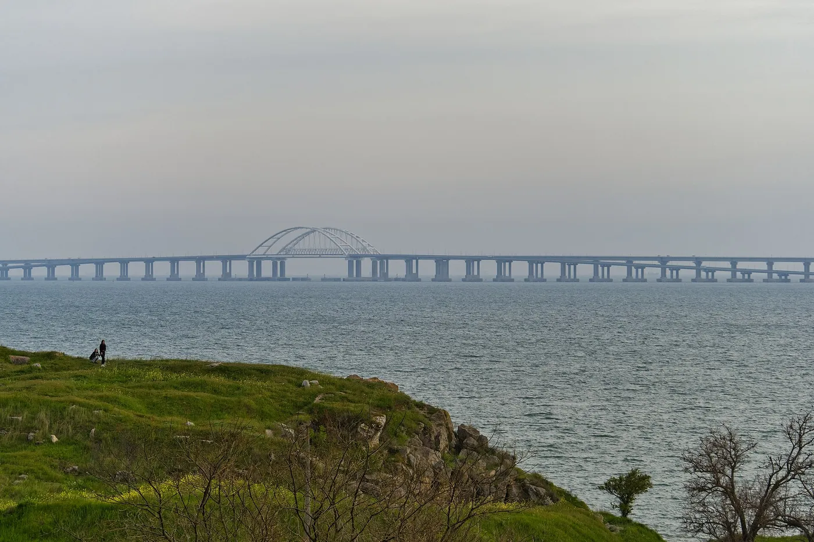
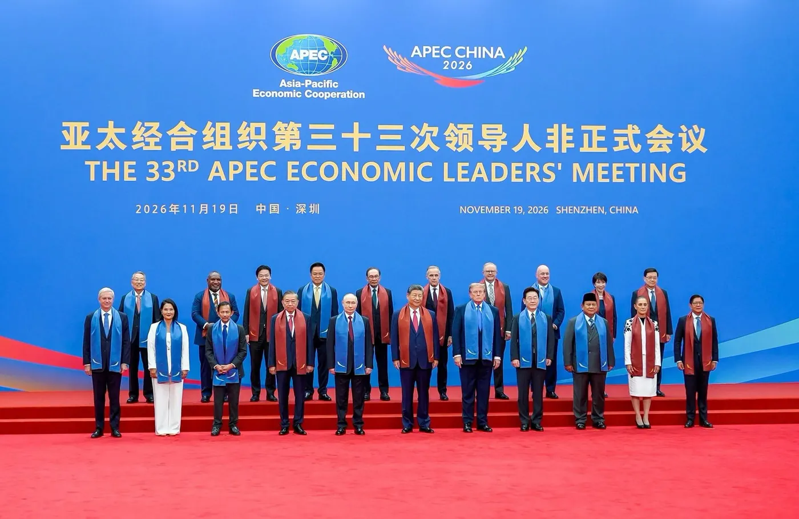
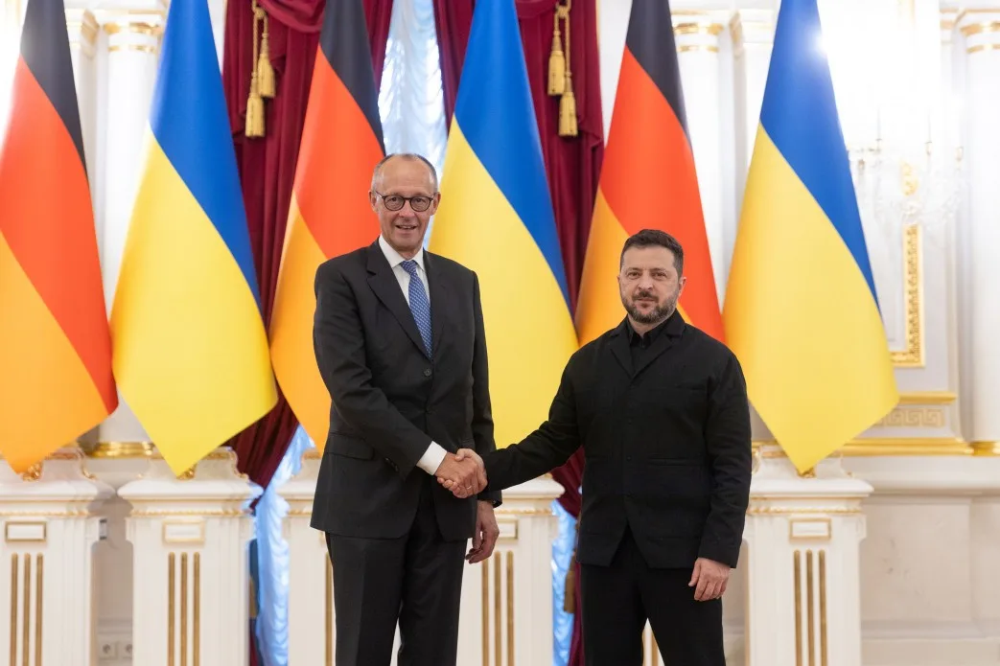

A follow-up to [Everyone Has an Angle](/en/posts/transatlantic-intentions-2026-11/). This week was unusually dense for news on the war: a bridge brought down, three leaders at one table in Shenzhen, 37 leaders meeting in Berlin. Beneath the noise, has anything really changed?

**The short answer**: the bridge strike was a heavy blow Ukraine landed on Putin before the talks, but it did not change the logic of a war of attrition. This winter is the last round of "fighting to negotiate". The real ceasefire window opens in the second half of 2027 at the earliest, and it is more likely to be a freeze than a peace.

## 1. What happened this week

Between 16 and 19 November, Ukraine struck the Crimean (Kerch) Bridge three times in four days:

- **Early 16 November**: the first strike; the bridge was closed.
- **Early 17 November**: a concentrated attack with Flamingo cruise missiles, Neptune missiles and heavy drones. A full road span in the middle of the bridge fell into the sea, cutting road traffic. Russia said two people were killed.
- **Early 19 November**: the rail bridge was hit. Trains were halted; Russia said they resumed that afternoon.

Zelensky described a weeks-long operation in seven phases: first picking off the air defence, radar and electronic-warfare systems covering Crimea, then concentrating on the bridge.

, CC BY 4.0, via Wikimedia Commons")

The timing was pointed: 17 November was two days before Putin's first three-way meeting with Trump and Xi Jinping in Shenzhen. Afterwards the three issued a "Declaration toward Peace" covering UN reform, energy supply and dialogue on nuclear risk. **It did not mention Ukraine at all.** Before the meeting Putin and Trump talked one-on-one for about 40 minutes; the Kremlin said Ukraine was the main topic, but "neither side made any particularly important statements". The same day, US envoys Steve Witkoff and Jared Kushner flew to Berlin to brief Zelensky and the leaders of the 37-nation Coalition of the Willing on Shenzhen.

## 2. The battlefield: Russia grinds, Ukraine reaches deep

- **On the ground**: Russia's main effort is still the southern flank of Donetsk's "Fortress Belt" around Pokrovsk, Kostiantynivka and Dobropillia, with 150 to over 200 clashes a day and slow but steady advances. In the south, a Ukrainian commander estimates about 50,000 Russian troops massed on the Huliaipole axis, aiming to cut Zaporizhzhia city's transport links. Ukraine has retaken some ground locally in Zaporizhzhia.
- **In the air**: Russian strikes on energy, bridges and water systems have clearly escalated. UN figures show civilian casualties in October 2026 were 95% higher than in October 2025. Ukraine is short of interceptors, and its own negotiators call its position going into winter "particularly vulnerable".
- **Long range**: Ukraine keeps hitting Russian refineries and oil facilities. With the bridge down, overland supply to Crimea has been squeezed onto the railway.

**Assessment**: neither side can force a decisive breakthrough. Russia can take ground slowly, at high cost; Ukraine can hold its main cities and is increasingly able to inflict "strategic" damage deep behind the lines. It is a classic stalemate of attrition, the kind where both sides at the table believe fighting a bit longer favours them.

## 3. What each player is calculating

### Russia: it wants more than territory

The 10 to 11 November talks in Abu Dhabi, the first three-way round in nine months, produced only a large prisoner exchange (possibly 1,000 for 1,000 up to 1,500 for 1,500). Russia insists Ukraine withdraw from the parts of Donetsk oblast it has not captured. According to The Telegraph, Moscow rejected a US compromise that would freeze the current line and let Ukraine keep the cities it holds.

More important, Russia got "European security architecture" onto the agenda for the first time: it wants NATO to cut its eastern-flank presence sharply, a written guarantee of no further enlargement, and has even floated "non-aggression pacts" with individual NATO members.

Putin's trump card is time: he believes winter strikes can break Ukraine's will and that Trump is in a hurry to close. But his economic ledger is deteriorating:

- GDP growth of only 0.5% to 1% in 2026;
- a federal deficit of RUB 5.234 trillion, or 2.3% of GDP, in January to October, with 3.2% expected for the year;
- a key rate held at 14%, and "quiet layoffs" spreading through companies;
- contract-soldier recruitment down roughly 10% year on year, by one independent estimate.

The one bright spot comes from the Middle East: the Iran war has pushed up oil prices, and in October Russia's fossil-fuel export revenue reached EUR 754 million a day, the highest since December 2022.

### The United States: Trump wants a deal, Congress is shifting

Trump wants a "war ended" headline, and his envoys treat Russia's European-security concerns as "fair to discuss", which is exactly what Europe fears most. But the constraints are growing. After the midterms, Democrats control Congress and are keener on aid to Ukraine. House Republican leaders are using the Ukraine aid, intelligence-sharing and Russia-sanctions provisions of the defence bill as bargaining chips against Democrats, with a deal expected in the first week of December. Washington has also complained about Ukraine's strikes on Russian energy facilities, which complicate both talks and oil prices.

### Europe: a seat at the table, but a weak hand

At the 13 November Dublin summit, EU leaders agreed their negotiating team: the "E5" of Germany, France, the UK, Italy and Poland plus the EU institutions, with NATO also involved. The line is clear: no borders changed by force, no reward for aggression, ceasefire first and European security architecture later, and NATO deployments on members' territory not up for discussion.

The money is following too. The Commission says Ukraine's 2026 funding gap is covered, and on 18 November it proposed a EUR 45 billion loan for 2027. New UK Prime Minister Andy Burnham announced a GBP 260 million winter package in Berlin, including 1,000 long-range strike drones.

Europe's problem is political weakness. Merz barely survived an electoral "disaster", Macron is at historic lows in the polls with Le Pen's camp surging ahead of next year's election, and Burnham replaced Starmer in July without a general-election mandate. Using frozen Russian assets is still stuck on how to share Belgium's risk. Privately, European officials think Putin is stringing Trump along and the talks will probably fail; they stay at the table mainly so that, if talks collapse, Washington blames Moscow.

### China: host, but not a player

Beijing staged the trilateral and deliberately kept Ukraine out of the declaration. It wants a showcase of great-power status and stable relations with Washington, not responsibility for any specific Russia-Ukraine arrangement.

## 4. Key calls (the author's subjective odds)

| Question | Probability |
|---|---|
| A full ceasefire before the end of 2026 | about 5% |
| A new multilateral round with European representatives formally in the room by end-January 2027 | about 55% |
| The US defence bill keeps the Ukraine aid and Russia sanctions provisions largely intact | about 65% |
| The EU's EUR 45bn loan for 2027 is approved before the end of Q1 2027 | about 70% |
| All 27 member states take part in that loan | about 40% |
| Frozen Russian central-bank assets are outright confiscated for Ukraine in 2027 | about 15% |
| Ukraine cedes unoccupied parts of Donetsk oblast in an agreement in 2027 | about 25% |
| Trump presses Kyiv noticeably harder than Moscow in the first half of 2027 | about 50% |

## 5. When does the war end?

My base case: the war is more likely to end in a frozen ceasefire than a peace treaty, and not soon.

- Ceasefire before end-2026: about 5%
- Ceasefire by end-June 2027: about 20%
- Ceasefire by end-2027: about 45%
- Still fighting in 2028 or later: about 55%

The most likely window is **the second half of 2027 to the first half of 2028**. Pressure for a ceasefire is building: Russia's growth has nearly stalled, its deficit is widening and recruiting is harder; Ukraine's deep-strike capability makes Moscow's "fighting on pays" calculation less certain; a shifting US Congress and renewed European money weaken Putin's bet on outlasting the West.

The obstacles are just as hard. Neither the territorial dispute (the rest of Donetsk) nor European security architecture (NATO's eastern flank) shows any room for compromise, and high oil prices from the Middle East give Moscow breathing space.

**Turning points to watch**:

1. Whether Russia accepts a freeze on the current line, or at least talks about a halt to strikes on energy facilities;
2. Whether Russia's 2027 budget forces deep non-military cuts, or a new compulsory mobilisation;
3. Whether Washington ties European-security talks to a Ukraine ceasefire to extract Russian concessions;
4. Whether Ukraine gets through this winter's grid offensive without widespread, prolonged blackouts.

**In one line**: you can bring down a bridge, but not the logic of attrition. The fighting this winter comes first; the talking comes after.

---

**Sources**: AP, BBC, Reuters, The Guardian (16–19 November); Kyiv Independent, Kyiv Post (16–19 November); Politico Europe, "Europe fears Putin is stringing Trump along on Ukraine" (18 November) and "Inside Ukraine's Coalition of the Wobbling" (19 November); Euronews, DW (11–19 November); OSW Centre for Eastern Studies (12 November); ISW / Critical Threats campaign assessments (14–18 November); General Staff of the Armed Forces of Ukraine; Russian Finance Ministry via Interfax (10 November); Bank of Russia (13 November); Bank of Finland BOFIT (6 November); CREA (12 November); NBC News via LIGA.net (19 November).

**Images**: the cover is the SBU's image of the damaged bridge (CC BY 4.0); inline, in order: the intact bridge (Alexxx1979, CC BY-SA 4.0), the APEC Shenzhen group photo (public domain), and Merz with Zelensky (CC BY 4.0), all via Wikimedia Commons.

*This post is reasoning based on public reporting; the probabilities are the author's subjective judgements and not investment advice. Translated from the Chinese original.*
