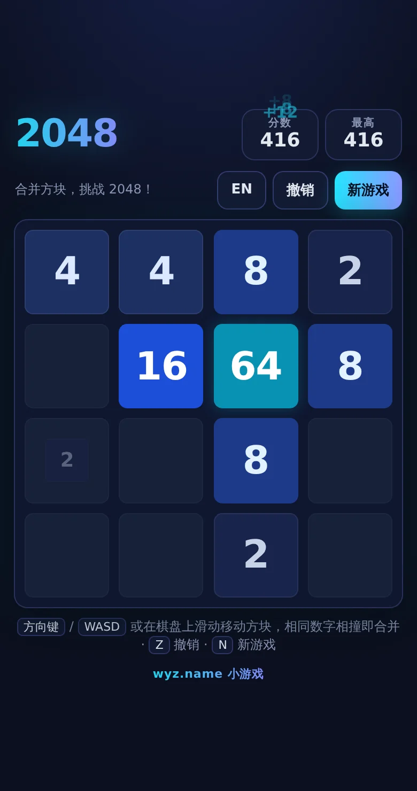

2048 was written over a weekend in 2014 by Italian developer Gabriele Cirulli, and within a week millions of people were playing it. On a 4×4 grid, every tile slides the same way at once; two equal numbers that collide merge into their sum, and each move adds a 2 or a 4 in an empty spot. Make 2048 to win, then keep going if you like.

This version saves automatically, so a page refresh picks up where you left off, and you can undo one move.



## How to play

**Phone:** swipe up, down, left or right on the board.

**Keyboard:** arrow keys or WASD, Z to undo, N for a new game.

**Tip:** pin your biggest tile in one corner and stick to three directions, say left, down and right, rarely up. That keeps the big tile in place and lets a row merge into the corner like a staircase.

---

**Images**: screenshots of the game on this site. Each game is a single web page with no tracking; your best score stays in your own browser.
