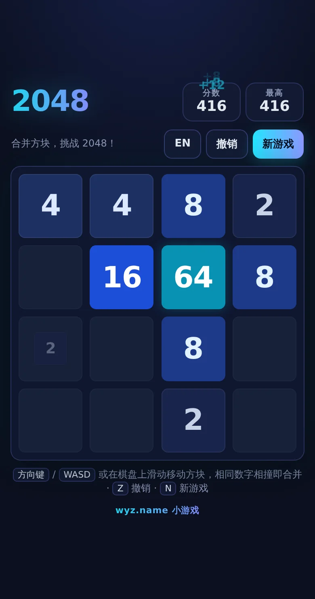

2048是意大利程序员加布里埃尔·奇鲁利2014年用一个周末写出来的，上线一周就有几百万人在玩。4×4的格子里，所有方块一起朝一个方向滑动，两个相同数字撞在一起就合成它们的和，每走一步会在空位冒出一个2或4。拼出2048就算赢，之后还能接着玩。

这一版会自动存档，刷新页面也能接着上一局；走错一步可以撤销一次。



## 怎么玩

**手机：** 在棋盘上上下左右滑动。

**键盘：** 方向键或 WASD，Z 撤销，N 开新游戏。

**小技巧：** 把最大的数字固定在一个角上，尽量只用三个方向，比如左、下、右，少按上。这样大数字不会被挤出角落，整行会像阶梯一样往角上合并。

---

**图片**：均为本站游戏实机截图。游戏为单文件网页，不联网、不收集数据，最高分只存在你自己的浏览器里。
