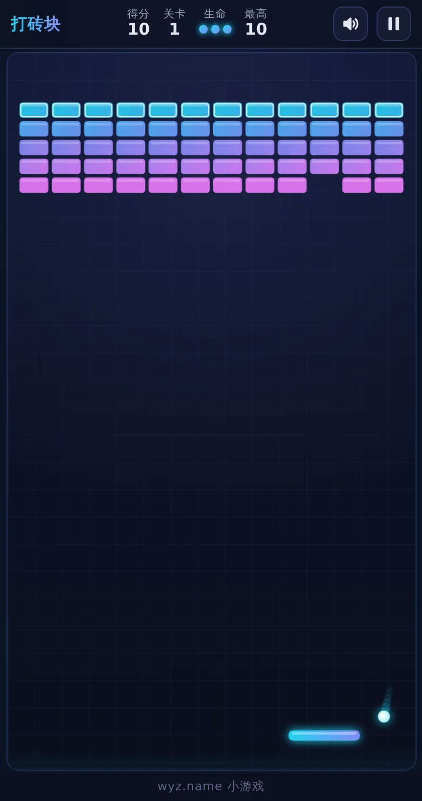

Breakout was Atari's 1976 arcade game, and Steve Jobs and Steve Wozniak are said to have worked on the original design. You slide a paddle left and right to keep the ball bouncing up into the bricks; let it fall and you lose a life.

This version gives you three lives and seven brick layouts, and the ball speeds up a little with each level. Some bricks take two hits and metal bricks can't be broken. Broken bricks sometimes drop timed power-ups: a wider paddle, multi-ball, or a slower ball.



## How to play

**Phone:** touch anywhere and drag left or right to move the paddle; tap to launch.

**Desktop:** mouse, ←→ or A/D to move, Space to launch, P to pause.

**Tip:** a hit in the middle of the paddle sends the ball straight up, a hit near the edge sends it off at an angle. Use the edge to sneak the ball up the side and behind the bricks, where it bounces around the top and clears a big chunk at once.

---

**Images**: screenshots of the game on this site. Each game is a single web page with no tracking; your best score stays in your own browser.
