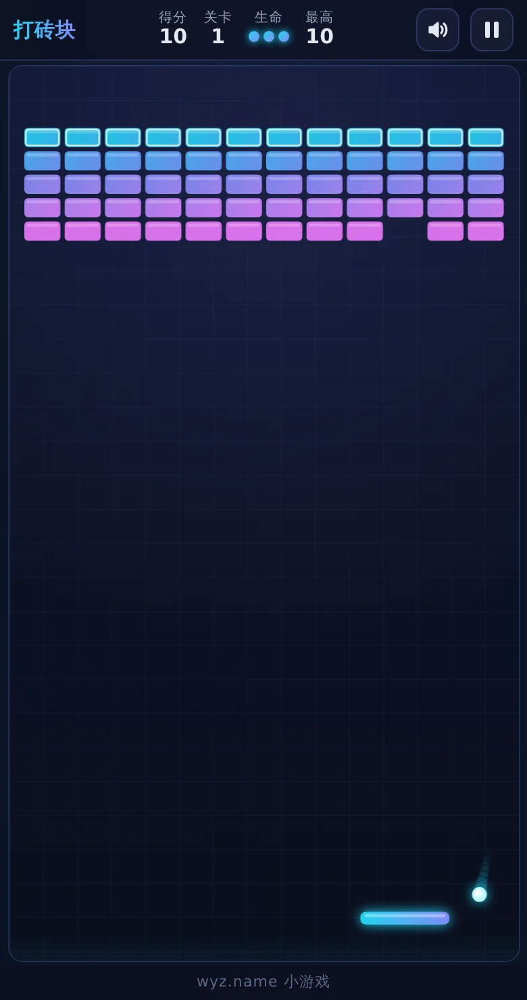

打砖块是雅达利1976年推出的街机，据说乔布斯和沃兹尼亚克参与过最初的设计。玩法就是左右移动挡板接住小球，让它反弹去撞碎上面的砖块，球掉下去就丢一条命。

这一版有三条命和七种关卡布局，过一关球会快一点。有的砖要打两下，金属砖打不碎。碎砖时偶尔会掉下道具：加宽挡板、多球、减速，都是限时的。



## 怎么玩

**手机：** 在画面上任意位置按住左右拖动挡板，轻点发射。

**电脑：** 鼠标、←→ 或 A/D 移动，空格发射，P 暂停。

**小技巧：** 球打在挡板中间是直着弹，打在边缘会斜着飞。想把球送到砖块后面去，就用挡板边缘去接，让它从侧面钻上去，在顶上来回弹，能一口气清掉一大片。

---

**图片**：均为本站游戏实机截图。游戏为单文件网页，不联网、不收集数据，最高分只存在你自己的浏览器里。
