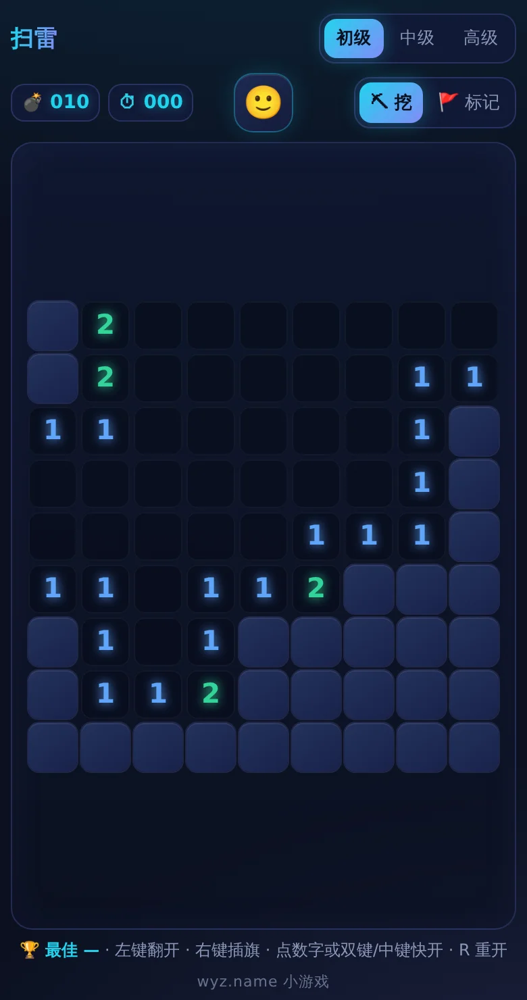

Minesweeper shipped with Windows from 1990, and for many people it was the first thing they played on a computer. Each number shows how many of the eight surrounding squares hide a mine. Use logic to open every square that isn't a mine and you win.

This version has three levels: Beginner (9×9, 10 mines), Intermediate (16×16, 40) and Expert (16×30, 99). Your first click is never a mine and always opens an area. Your best time is kept for each level.



## How to play

**Phone:** switch between ⛏ Dig and 🚩 Flag at the top right, or long-press a square to flag it (with a short vibration). On Intermediate and Expert the squares are small on a phone, so the board scrolls inside its frame.

**Desktop:** left-click to open, right-click to flag. When a number has all its flags placed, click it to open the remaining neighbours. R restarts, 1, 2 and 3 change the level.

**Tip:** look first for a 1 touching just one closed square; that square is a mine. Then learn the 1-2-1 and 1-2-2-1 patterns, which settle a lot of guesses.

---

**Images**: screenshots of the game on this site. Each game is a single web page with no tracking; your best score stays in your own browser.
