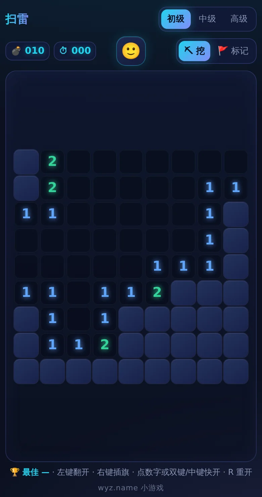

扫雷从1990年起随 Windows 预装，很多人第一次用电脑玩的就是它。格子里的数字表示它周围八格里藏着几颗雷，靠推理把所有不是雷的格子都翻开就赢了。

这一版有初级（9×9，10颗雷）、中级（16×16，40颗）和高级（16×30，99颗）三档。第一下点哪里都不会是雷，还会直接翻开一片。每档的最好成绩会单独记下来。



## 怎么玩

**手机：** 右上角切换「⛏ 挖 / 🚩 标记」，或者长按一个格子插旗（会轻轻震一下）。中级和高级在手机上格子比较小，棋盘可以在框里滑动。

**电脑：** 左键翻开，右键插旗；周围旗子插够了，点一下数字就能把剩下的邻格一起翻开。R 重开，1、2、3 换难度。

**小技巧：** 先找「1」贴着一个未翻格的地方，那格一定是雷；再看「1-2-1」「1-2-2-1」这些固定组合，能省很多猜测。

---

**图片**：均为本站游戏实机截图。游戏为单文件网页，不联网、不收集数据，最高分只存在你自己的浏览器里。
