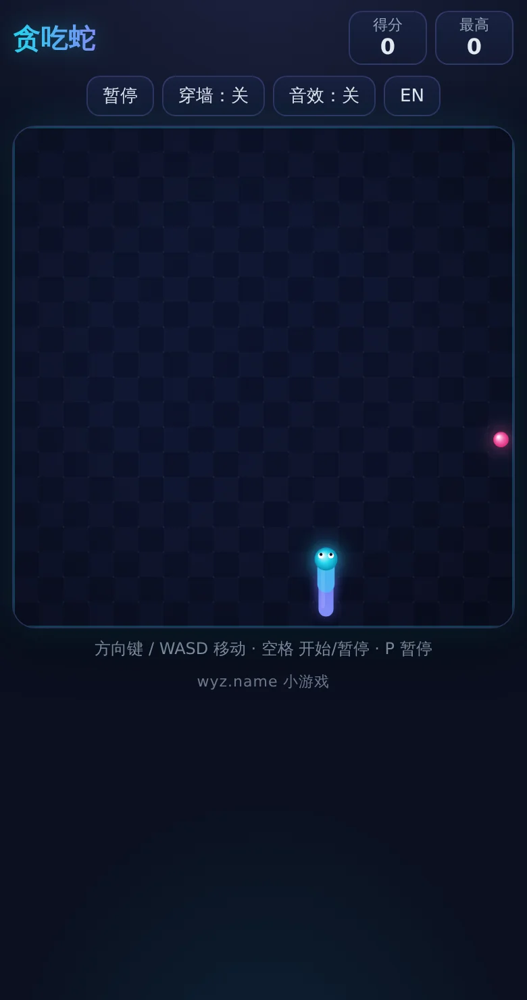

Snake goes back to the 1976 arcade game Blockade, but what made it famous worldwide was the version preinstalled on the Nokia 6110 in 1997. The rules are simple: eat food to grow, hit a wall or yourself and it's over.

This version uses a 20×20 board. Each food is worth 10 points and the snake speeds up a little each time. Now and then a gold bonus appears with a countdown ring; grab it before it vanishes for 20 to 50 extra points. Turn on Wrap in the settings and the snake passes through walls, which makes it much easier.



## How to play

**Phone:** swipe on the board to turn, or use the big D-pad below it.

**Keyboard:** arrow keys or WASD to move, Space to start or pause, P to pause.

**Tip:** two quick presses chain two turns, and a direct U-turn is ignored, so you won't kill yourself by accident. Once the snake gets long, loop along the edges and keep the middle open.

---

**Images**: screenshots of the game on this site. Each game is a single web page with no tracking; your best score stays in your own browser.
