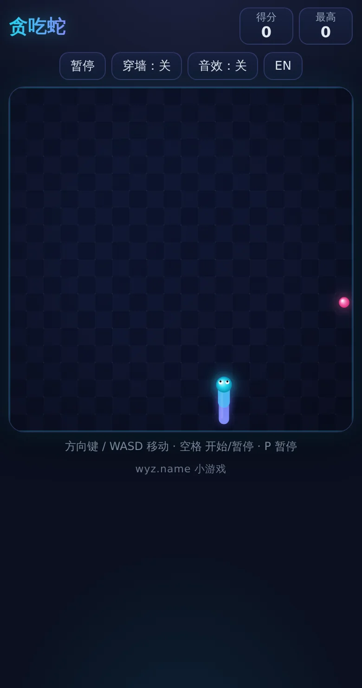

贪吃蛇的原型是1976年的街机《Blockade》，真正让它红遍全世界的是1997年诺基亚6110手机里预装的那一版。规则简单：吃到食物身体变长，撞墙或撞到自己就结束。

这一版是20×20的棋盘，每吃一个食物加10分，速度一点点变快。时不时会冒出一颗金色奖励，带倒计时圈，赶在消失前吃到可以多拿20到50分。设置里可以打开「穿墙」，从一边出去会从另一边回来，难度低很多。



## 怎么玩

**手机：** 在棋盘上滑动转向，或者用下方的大方向键。

**键盘：** 方向键或 WASD 移动，空格开始或暂停，P 暂停。

**小技巧：** 快速连按两次方向可以连续转弯，直接掉头会被忽略，不会把自己撞死。蛇长了以后沿着边绕圈走，给中间留出空间。

---

**图片**：均为本站游戏实机截图。游戏为单文件网页，不联网、不收集数据，最高分只存在你自己的浏览器里。
