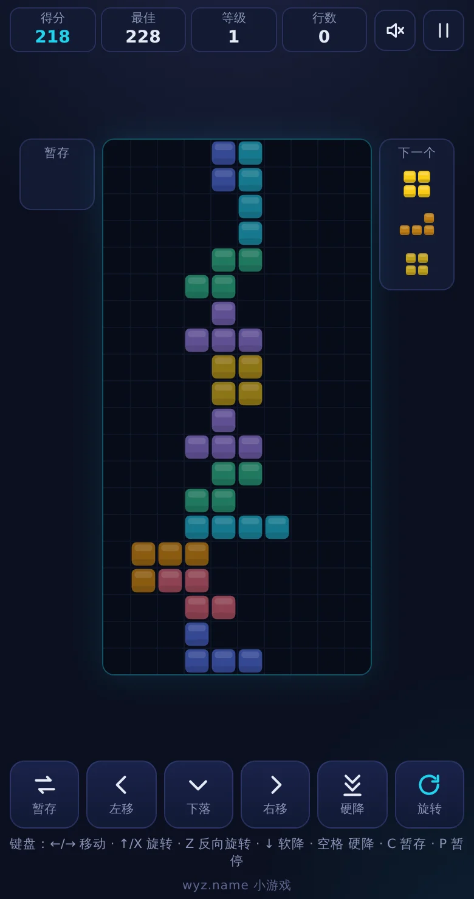

俄罗斯方块是1984年苏联程序员帕基特诺夫在莫斯科写出来的，四十多年过去，规则一句话就能讲完：七种方块往下掉，把一整行填满，这一行就消掉；堆到顶，游戏结束。

这一版按现代规则做的：7 个一包的随机序列（不会连着很久不来长条），能看到接下来 3 个方块，可以暂存一个，还有落点虚影和 0.5 秒的落地缓冲，方块贴地后还能挪一下。每消 10 行升一级，下落越来越快。



## 怎么玩

**手机：** 底部六个按钮（暂存、左、下、右、硬降、旋转），左右和下按住会连发；也可以在棋盘上左右滑动移动，轻点旋转，下滑直接落到底，上滑暂存。

**键盘：** ←→ 移动，↑ 或 X 旋转，Z 反向旋转，↓ 软降，空格硬降，C 暂存，P 暂停。

**小技巧：** 留出最右边一列不填，攒够四行再放长条，一次消四行得分最高（800 × 等级）。

---

**图片**：均为本站游戏实机截图。游戏为单文件网页，不联网、不收集数据，最高分只存在你自己的浏览器里。
