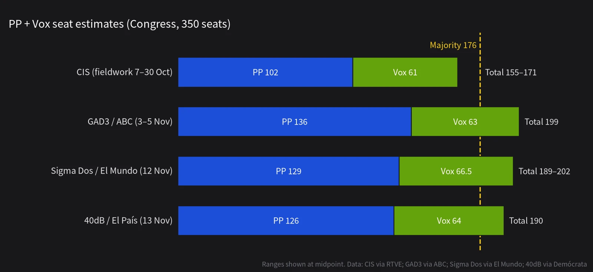

The short answer: **Pedro Sánchez's eight years in power will probably end on 29 November, and Alberto Núñez Feijóo will probably be the next prime minister. But the People's Party (PP) cannot reach 176 seats on its own. It needs Vox.**

So the real uncertainty is not who wins but how. Will Vox vote for a PP government from outside, or will it take seats in Spain's national cabinet for the first time? My view is that the second is slightly more likely.

Below I explain why the election was called, then go through the polls and the coalition arithmetic, and finish with forecasts. Each one carries a probability and a date by which it can be checked.

## 1. Why a snap election

This parliament could have run until summer 2027. What cut it short was **housing**.

- In September 2026, the eviction of an 87-year-old by a real-estate company set off protests across the country.
- On 2 October, Sánchez's housing relief decrees were defeated in Congress. The decisive votes came from the Catalan party Together for Catalonia (Junts), which had already withdrawn its support for the government in October 2025.
- On 5 October, Sánchez announced the dissolution of parliament. The decree was published in the official gazette on 6 October, setting election day for 29 November and the opening of the new parliament for 23 December.

Sánchez's plan was clear: turn the vote into a referendum on who is actually tackling housing. The campaign has not followed that script:

- **On 28 October, a high-speed train crashed near Urda in the province of Toledo.** A service run by the state operator Renfe ran into a stationary train belonging to the private company Iryo, killing 69 people. It was Spain's second fatal high-speed crash this year, after a January collision that killed 46. Transport Minister Óscar Puente later resigned.
- The corruption cases have not gone away. The "Koldo affair", involving former transport minister José Luis Ábalos and the party's former organisation secretary Santos Cerdán, is still unfolding, and on the first day of the campaign there were fresh reports about the Socialists' (PSOE) donation accounts.
- A general strike took place on 11 November, and the right has kept pressing on immigration, including the 2026 Ceuta migrant crisis and the government's immigration amnesty.

## 2. The polls: most say the right has a majority, only the CIS says no

### The mainstream polls

The large polls published as the campaign opened:

- **40dB (for El País and Cadena SER, 13 November)**: PP 31.5%, 126 seats; PSOE 29.4%, 118; Vox 18.8%, 64. **PP + Vox: 190 seats**, 14 above the majority line.
- **Sigma Dos (for El Mundo, 12 November)**: PP 30.8%, 126–132 seats; PSOE 25.3%, 103–108; Vox 19.6%, 63–70. PP + Vox: **189–202**.
- **GAD3 (for ABC, fieldwork 3–5 November)**: PP 136, PSOE 103, Vox 63, **199 combined**.
- **Polling average** (Demócrata, 15 pollsters, 12 November): PP 31.5%, PSOE 26.7%, Vox 19.1%, Frente Amplio 6.2%.

Compared with 2023, the PP is roughly flat (it won 137 seats then), the PSOE falls from 121 to just over 100, and **Vox roughly doubles from 33 to the mid-60s**. Nearly all the growth on the right belongs to Vox. 40dB estimates that about one in five 2023 PP voters will switch to Vox.

### The outlier: the CIS

The state-run Centre for Sociological Research (CIS) published its pre-election survey on 12 November, with a sample of 45,000. It reaches the opposite conclusion: **PSOE 33.3% and 134–143 seats, PP 25.5% and 98–106, Vox 18.4% and 57–65**. Even at the top of their ranges, PP and Vox would total only 171 and fall short.

Two caveats. The CIS is chaired by José Félix Tezanos, a former senior Socialist official. And RTVE itself notes that in 2023 the CIS overestimated the left, underestimated Vox and insisted that the PSOE would win, which did not happen. Among the main pollsters, only SW Demoscopia joins the CIS in showing the PSOE ahead. I give the CIS little weight in the forecasts below, but not zero.

### The left has split

The PSOE's problem is not only its own vote. Its partners to the left have split. Deputy Prime Minister Yolanda Díaz announced in February 2026 that she would not run again. Sumar was rebuilt as Frente Amplio (Broad Front), led by Ada Colau, while Podemos is running separately under Irene Montero. Together they won 31 seats in 2023. This time the polls give Frente Amplio somewhere between 5 and 15 seats, and Podemos between zero and one.

Under the D'Hondt system, small provinces elect only three to five deputies each, so a divided left wastes a large share of its votes. **That is the arithmetic behind the right's comfortable path to 176.**

## 3. The coalition arithmetic

Spain's prime minister is chosen in an investiture vote in Congress. The first ballot requires an absolute majority (176 votes). If it fails, a second ballot 48 hours later needs only more yes votes than no votes. If no candidate succeeds within two months of the first ballot, parliament is dissolved and a new election is called.

### Does the PP need Vox?

**Almost certainly.** The mainstream polls put the PP's central estimate between 126 and 136 seats. Adding small allies such as the Navarrese People's Union (UPN) and Canarian Coalition (CC) does not come close to 176. And the regional parties that have occasionally worked with the right in the past, such as Junts and the Basque Nationalist Party (PNV), find it very hard to vote alongside Vox.

The other route would be a PSOE abstention, and Feijóo has closed it himself: "Sánchez's PSOE? My degree of naivety, at my age and with my experience, doesn't allow it."

### In the cabinet or outside it?

Feijóo's public position is that **his goal is a PP-only government with parliamentary support from Vox**, but that "making or not making a coalition government does not depend on me", it depends on the voters. He has not ruled out giving Vox a key ministry such as Interior, Foreign Affairs or Defence, saying only that he will answer "when we get to that point".

Why I think a coalition is the more likely outcome:

1. **Precedent.** The PP currently governs with Vox in four regions: Andalusia, Aragon, Extremadura and Castile and León. Feijóo himself says he accepted Vox ministers there because the alternative was a repeat election.
2. **Leverage.** If Vox really wins 60-plus seats and the PP sits around 130, Vox is the only route to a majority. The more seats it has, the less likely it is to settle for voting yes from outside.
3. **Competition.** In 40dB's preferred-prime-minister question, Abascal (21.2%) and Feijóo (21.1%) are now level. For Vox, joining the cabinet is a chance to prove it can govern.

Feijóo's red lines are "nothing outside the Constitution" and "no recentralisation". On Vox's signature "national priority", he says the two parties have already agreed a version at regional level, and "it is not the one Vox proposes". All of that leaves room to negotiate. None of it shuts the door.

## 4. My forecasts (as of 13 November 2026)

### 1. Who becomes prime minister

| Outcome | Probability |
|---|---|
| Feijóo wins an investiture vote by 31 January 2027 | **80%** |
| 　of which: PP–Vox coalition (Vox has ministers) | 45% |
| 　of which: PP minority government with Vox support from outside | 32% |
| 　of which: other arrangements (e.g. PSOE abstention) | 3% |
| Sánchez re-elected | **10%** |
| No prime minister elected by 31 January 2027 (deadlock) | 10% |

If Feijóo does become prime minister, the conditional probability that Vox enters the cabinet is about 56%. **The signal to watch**: if on election night Vox clears 65 seats and the PP stays below 130, a coalition becomes much more likely. If the PP gets close to 140, Feijóo can afford to offer Vox a parliamentary deal and no ministries.

### 2. Seats and votes

- **The PP is the largest party: 88%.**
- **PP seat range**: below 120, 10%; 120–134, 55%; 135–149, 30%; 150 or more, 5%.
- **PP + Vox reach 176 seats: 80%; reach 190: 45%.**
- **Vox wins at least 60 seats: 65%; more than 20% of the vote: 35%.**
- **PSOE wins at least 110 seats: 40%; at least 100: 85%.**
- **Frente Amplio (including its allied regional lists) wins fewer than 15 seats: 75%; Podemos wins one seat or none: 85%.**

### 3. Turnout

Turnout in July 2023 was 70.4%, in the middle of summer. Sigma Dos estimates 76.7% this time, and 83.1% of CIS respondents say they will "certainly" vote, though self-reported figures like these always run high.

- **Turnout above 2023's 70.4%: 65%; 75% or higher: 25%.**

### 4. After the vote

- **A repeat election (spring 2027) because no one is elected within two months: 5%.** This only happens if the CIS turns out to be right and both blocs fall a few votes short.
- **If the PSOE loses power, Sánchez steps down as party leader by 30 June 2027: 50%.** He is a politician who stakes his career on comebacks, and after being pushed out in 2016 he came back to win the leadership again, so I cannot put this any higher.

## 5. In one sentence

**This election will probably end the Sánchez era, but it is more likely to be remembered as the moment Vox entered Spain's national government.** After Franco's death in 1975, Spain was long seen as a European country "immune" to the far right. That idea broke when Vox entered Congress in 2019. This vote may rewrite it completely.

**The forecast I am most confident in**: whoever forms the government, Vox will come close to doubling its seats, and its weight within the right will only grow.

**The one thing most likely to prove me wrong across the board**: the CIS is right. In other words, the private polls are systematically underestimating the PSOE and overestimating Vox, or something in the last two weeks changes the agenda, such as a dramatic turn in the first televised debate on the 16th.

---

**Dates to watch**

- **16 November**: Feijóo–Sánchez head-to-head TV debate
- **23 November**: last day polls can be published (a ban starts on 24 November)
- **26 November**: four-way debate (Feijóo, Sánchez, Abascal, Colau)
- **29 November**: election day, with a provisional count that night
- **From 4 December**: votes from Spaniards abroad are added in the general count, which can move individual seats
- **23 December**: the new parliament opens, followed by the King's consultations and the nomination of a candidate
- **January 2027**: the likely window for the investiture vote

**Sources**: Demócrata (40dB daily tracking, 13 November; polling average, 12 November; summary of Feijóo's El País interview, 8 November); El Mundo (Sigma Dos tracking, 12 November); ABC (GAD3, 12 November); RTVE (CIS pre-election survey, 12 November); France 24 (Urda crash, 29 October; polls and election background, 9 November); Wikipedia, "2026 Spanish general election" (background, election timetable, debate schedule, polling averages).

**Images**: cover shows the Congress of Deputies in Madrid (photo by Vickybol, CC BY-SA 3.0, via Wikimedia Commons); the polling chart is our own.

*This is personal reasoning based on public reporting, and the probabilities are subjective. Come back on 30 November and again in January to check them.*
