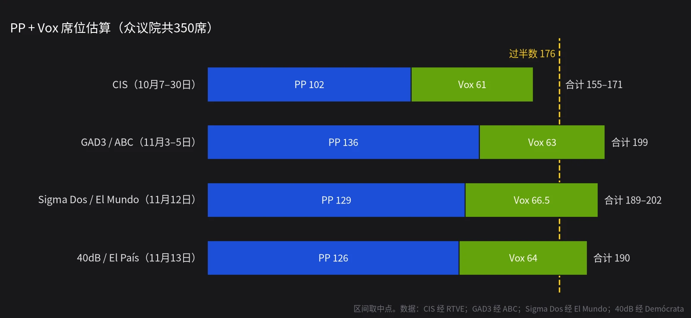

先给答案：**桑切斯八年的执政大概率在11月29日结束，费霍（Alberto Núñez Feijóo）大概率成为下一任首相。但人民党（PP）自己拿不到176席，必须靠Vox。**

所以这场选举真正的悬念不是"谁赢"，而是"怎么赢"：Vox是在议会外面投票支持，还是第一次坐进西班牙中央政府的内阁？我的判断是后者略占上风。

下面先讲为什么提前大选，再看民调和组阁算术，最后给出预测。每一条都标了概率和可检验的时间点。

## 一、为什么提前大选

这届议会本来可以干到2027年夏天。把它提前打断的是**住房**。

- 2026年9月，一位87岁老人被房地产公司强制驱逐，引发全国性抗议。
- 10月2日，桑切斯的住房纾困法令在众议院被否决。关键一票来自加泰罗尼亚的"一起为加泰罗尼亚"（Junts），它在2025年10月已经撤回了对政府的支持。
- 10月5日，桑切斯宣布解散议会、提前选举；10月6日解散令刊登在官方公报上，选举日定在11月29日，新议会12月23日开幕。

桑切斯的算盘很清楚：把选举打成"谁在解决住房问题"的公投。但开局之后，局面并不按剧本走：

- **10月28日，托莱多省乌尔达（Urda）发生高铁追尾**，国营Renfe的列车撞上停在轨道上的私营Iryo列车，69人遇难。这是西班牙今年第二起致命高铁事故（1月那次死了46人）。交通部长普恩特（Óscar Puente）随后辞职。
- 腐败调查没有停：前交通部长阿瓦洛斯和党组织书记塞尔丹卷入的"科尔多案"仍在发酵，竞选首日还有关于工人社会党（PSOE）捐款账目的新报道。
- 11月11日爆发全国总罢工；移民问题（包括2026年休达移民危机和政府的移民特赦）也被右翼持续放大。

## 二、民调：多数说右翼过半，只有CIS说不

### 主流民调

竞选开跑这几天公布的几份大样本民调：

- **40dB（为《国家报》和SER电台，11月13日）**：PP 31.5%、126席；PSOE 29.4%、118席；Vox 18.8%、64席。**PP+Vox合计190席**，比过半线多14席。
- **Sigma Dos（为《世界报》，11月12日）**：PP 30.8%、126–132席；PSOE 25.3%、103–108席；Vox 19.6%、63–70席。PP+Vox **189–202席**。
- **GAD3（为ABC，11月3–5日调查）**：PP 136、PSOE 103、Vox 63，**合计199席**。
- **民调平均**（Demócrata，15家机构，11月12日）：PP 31.5%、PSOE 26.7%、Vox 19.1%、"广泛阵线"6.2%。

和2023年对比：PP基本持平（当时137席），PSOE从121席掉到100出头，**Vox从33席翻倍到60多席**。右翼阵营的增长几乎全部是Vox的。40dB估计，2023年投PP的人里约有五分之一这次会转投Vox。

### 唯一的异类：CIS

官方的社会学调查中心（CIS）11月12日公布了样本量4.5万人的选前大调查，结论完全相反：**PSOE 33.3%、134–143席，PP 25.5%、98–106席，Vox 18.4%、57–65席**。PP+Vox即使取上限也只有171席，过不了半数。

但要注意两点：CIS现任主席特萨诺斯（José Félix Tezanos）是工人社会党前高层；RTVE自己也指出，2023年CIS高估了左翼、低估了Vox，而且坚持认为PSOE会赢，结果并没有。主要机构里，除了CIS，只有SW Demoscopia给出PSOE领先的数字。我在下面的预测里给CIS的权重很低，但不是零。

### 左边碎了

PSOE的问题不只在自身。它左边的伙伴分裂了：副首相约兰达·迪亚斯2026年2月宣布不再参选，原来的"联合"（Sumar）重组成了科劳（Ada Colau）领衔的"广泛阵线"（Frente Amplio），而"我们能"（Podemos）另起炉灶，由伊琳娜·蒙特罗挂帅。2023年两家合起来31席，这次各家民调给"广泛阵线"大约5到15席，Podemos是0到1席。

在D'Hondt比例代表制下，小省份只有3到5个席位，分裂的左翼会白白浪费大量选票。**这才是右翼能稳过176席的数学原因。**

## 三、组阁算术

西班牙首相由众议院"授权"（investidura）产生：第一轮需要绝对多数（176票），失败的话48小时后进行第二轮，只要赞成票多于反对票即可。从第一轮投票起算两个月内没人当选，议会自动解散、重新选举。

### PP需要Vox吗？

**几乎肯定需要。** 主流民调给PP的中值都在126到136席之间。即使把纳瓦拉人民联盟（UPN）和加那利联盟（CC）这类小党算上，也远不到176。而Junts、巴斯克民族党（PNV）这些过去偶尔和右翼合作的地区党，都很难和Vox站在一起投票。

另一条路是让PSOE弃权放行，费霍自己已经堵死了："桑切斯的PSOE？我这个年纪、这种经验，不允许我这么天真。"

### 入阁还是外部支持？

费霍的公开立场是：**目标是PP单独执政，Vox在议会提供支持**；但"搞不搞联合政府不取决于我，取决于选民"。他没有排除让Vox拿内政、外交或国防这类核心部委，只说"到那一步再回答"。

为什么我认为联合政府的可能性更大：

1. **先例。** PP目前在安达卢西亚、阿拉贡、埃斯特雷马杜拉、卡斯蒂利亚-莱昂四个自治区和Vox联合执政。费霍自己说，接受Vox入阁，是因为不接受就只能重选。
2. **筹码。** 如果Vox真拿到60多席，而PP只有130上下，Vox就是唯一的通道。席位越多，它越不会满足于在场外投赞成票。
3. **竞争。** 40dB的"首相偏好"里，阿瓦斯卡尔（21.2%）和费霍（21.1%）已经并驾齐驱。对Vox来说，入阁是证明自己"能执政"的机会。

费霍的红线是"不违宪、不搞中央集权化"，在Vox主打的"本国人优先"上，他说双方在地区层面已经谈过一个版本，"不是Vox提的那个"。这些都是可以谈的范围，不是关门。

## 四、我的预测（截至2026年11月13日）

### 1. 谁当首相

| 结果 | 概率 |
|---|---|
| 费霍在2027年1月31日前通过授权投票成为首相 | **80%** |
| 　其中：PP–Vox联合政府（Vox有部长） | 45% |
| 　其中：PP少数政府，Vox议会外支持 | 32% |
| 　其中：其他组合（如PSOE弃权） | 3% |
| 桑切斯连任 | **10%** |
| 到2027年1月31日仍无人当选（僵局） | 10% |

如果把条件限定在"费霍当选"，Vox入阁的条件概率大约是56%。**最值得盯的信号**：选举之夜如果Vox超过65席、PP低于130席，联合政府的概率会明显升高；反过来，PP如果接近140席，费霍就有本钱只给Vox议会协议、不给部长。

### 2. 席位与选票

- **PP成为第一大党：88%。**
- **PP席位区间**：低于120席 10%；120–134席 55%；135–149席 30%；150席以上 5%。
- **PP+Vox合计达到176席：80%；达到190席：45%。**
- **Vox席位不少于60席：65%；得票率超过20%：35%。**
- **PSOE席位不少于110席：40%；不少于100席：85%。**
- **"广泛阵线"（含其地区盟友名单）少于15席：75%；Podemos不超过1席：85%。**

### 3. 投票率

2023年7月的投票率是70.4%（时值盛夏）。Sigma Dos估计这次能到76.7%，CIS调查里83.1%的人说"肯定会去投票"，但这类自报数字向来偏高。

- **投票率高于2023年的70.4%：65%；达到75%：25%。**

### 4. 选后

- **因两个月内无人当选而重新选举（2027年春）：5%。** 只有在CIS的世界成真、两大阵营都差几票时才会发生。
- **若PSOE失去政权，桑切斯在2027年6月30日前卸任党魁：50%。** 他是把政治生命押在"不可能复活"上的人，2016年被赶下台后又杀回来过，所以这一条我给不了更高。

## 五、一句话

**这场选举大概率会终结桑切斯时代，但它更可能被记住的，是Vox第一次进入西班牙中央政府。** 1975年佛朗哥死后，西班牙曾被视为"对极右翼免疫"的欧洲国家，这个说法2019年Vox进议会时就破了，这一次可能会被彻底改写。

**我最有信心的一条**：无论谁组阁，Vox的席位都会接近翻倍，它在右翼阵营里的话语权只会上升。

**最可能让我全盘出错的一件事**：CIS是对的。也就是私营民调系统性低估了PSOE、高估了Vox，或者最后两周发生一次改变议程的大事件（比如16日的首场电视辩论出现大逆转）。

---

**要盯的时间点**

- **11月16日**：费霍对桑切斯的一对一电视辩论
- **11月23日**：民调最后发布日（11月24日起禁止发布民调）
- **11月26日**：四方辩论（费霍、桑切斯、阿瓦斯卡尔、科劳）
- **11月29日**：投票日，当晚出初步计票
- **12月4日起**：海外选民选票计入总计票，个别席位可能变动
- **12月23日**：新一届议会开幕，随后国王咨询各党、提名首相候选人
- **2027年1月**：授权投票的大概窗口

**数据来源**：Demócrata（40dB每日追踪，11月13日；民调平均，11月12日；费霍《国家报》专访综述，11月8日）；《世界报》（Sigma Dos追踪，11月12日）；ABC（GAD3，11月12日）；RTVE（CIS选前调查，11月12日）；France 24（10月29日乌尔达事故，11月9日民调与提前大选背景）；维基百科"2026 Spanish general election"条目（背景、选举日程、辩论安排、民调汇总）。

**图片**：封面为马德里众议院大楼（Vickybol 摄，CC BY-SA 3.0，经 Wikimedia Commons）；民调图为本站自制。

*本文是基于公开报道的个人推理，概率是主观判断。欢迎11月30日和明年1月回来对账。*
