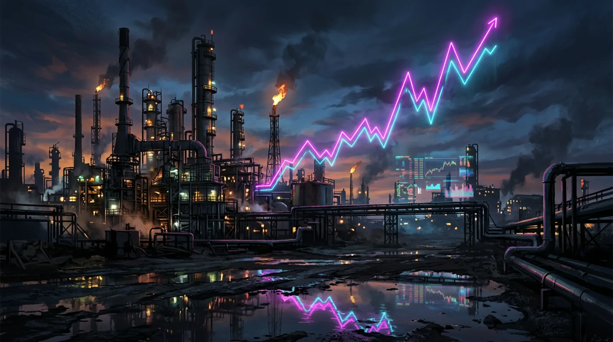

In [A Restless Autumn](/en/posts/europe-autumn-2026/) on 1 November, I named the US midterms and the eurozone's October flash inflation as the two variables most worth watching. Both have now been answered: Democrats won both chambers of Congress, and eurozone inflation rose to 4.0%. This post follows up on that piece.

## 1. The results: a bigger "blue wave" than most forecasts

**Senate**: before the vote Republicans held a 53–47 majority, so Democrats needed a net gain of four seats. According to CBS News projections as of the evening of 4 November (US Eastern time), Democrats have locked in at least 54 seats, flipping seven Republican seats in North Carolina, South Carolina, Texas, Kansas, Iowa, Ohio and Maine, while holding Georgia, New Hampshire and Michigan. In Texas, Talarico beat Paxton; in Maine, Jackson defeated five-term senator Collins; and Kansas elected a Democratic senator for the first time in nearly a century.

**Still undecided**: at the time of writing, **Alaska** (Sullivan vs. Peltola) and **Mississippi** (Hyde-Smith vs. Collom) had no result, and CBS rated both "toss-ups"; in Mississippi the candidates were only dozens of votes apart, with about 15,000 provisional ballots still to count. Neither seat affects control; they only decide whether Democrats end with 54, 55 or 56 seats.

**House**: before the vote Republicans held 219 seats and Democrats 214. CBS News projected on the evening of 3 November that Democrats would retake the House; according to Euronews, by 10:05 CET on 4 November Democrats had 228 seats (218 is a majority) to the Republicans' 139, with dozens still uncalled. Democratic leader Jeffries expects "at least 255". Current Speaker Johnson has said he will not run for minority leader.

According to CBS exit polls, Trump's approval is about 38%, and 89% of voters said the cost of living was an important factor in their vote. The new Congress takes office in January 2027; until then Republicans keep their majorities in both chambers.

## 2. Eurozone inflation in October: 4.0%, driven by energy

Eurostat's flash estimate of 4 November shows:

| Indicator | October | September |
|---|---|---|
| Headline inflation (HICP) | **4.0%** | 3.8% |
| Core (excl. energy, food, alcohol and tobacco) | 2.5% | 2.5% |
| Energy | 20.8% | 18.9% |
| Services | 3.3% | 3.2% |
| Month on month | +0.4% | — |

This is the first 4% reading since September 2023, in line with market expectations. Countries differ sharply: Italy 5.6%, Greece 5.6%, Belgium 5.2%, Spain 4.9%, France 3.8%, Germany 2.8% (where it even eased slightly month on month). Full data are due on 18 November.

The notable point is the gap between headline and core: headline inflation keeps rising, while core holds at 2.5%. The pressure comes mainly from energy prices driven up by the Iran war and has not yet clearly spread to wages and services.

## 3. What it means for Europe

**1. Tariffs and trade: a new Congress does not mean tariffs go away.** Euronews reports that after the Supreme Court struck down the emergency tariffs in February, the administration moved them under Section 301 of the Trade Act, which the president can use without a vote in Congress. Democrats can hold hearings and stall nominations, but they will struggle to take this power back. ING economists even argue that a president hemmed in at home may lean more on unilateral trade tools, and new tariffs on Europe cannot be ruled out. A survey cited by the EU Institute for Security Studies (EUISS) found that only 37% of Democratic voters think tariffs on the EU should be removed. The 15% baseline tariff framework is very likely to stay in place in the short term.

**2. Ukraine and Russia sanctions: an extra brake, but the money may not arrive.** Democrats broadly support aid to Ukraine, are already challenging Trump's move to allow Russian diesel imports, and have pledged to oppose troop withdrawals from Europe (EUISS). But scholars at the European Council on Foreign Relations warn that over the past two years the White House has let funds approved by Congress expire through delayed spending, so "money Congress writes into law for Ukraine is not necessarily money the president will spend". The EU is working to fill Ukraine's funding gap of about €70 billion next year (AFP). Many analysts also worry that a president frustrated at home will turn to foreign policy as an outlet, which would raise uncertainty for Europe rather than lower it.

**3. The ECB: about a 70% chance of a December hike.** The ECB deposit rate stands at 2.50%. According to CNBC, after the data release markets priced the chance of a hike at the 17 December meeting at more than 72%. Turmoil in the French bond market is seen as a constraint, however: if financing costs rise further, the ECB will be more cautious about hiking.

**4. The euro and markets: risk appetite returns.** On 4 November the Stoxx 600 closed up 1.82% at 657.40, its highest since 26 August, led by banks up about 4.6%; clean-energy stocks rose and defence stocks fell (Reuters via Euronext, Euronews). The dollar weakened, with the euro up about 0.5% to around $1.1247 (Euronews), while the German 10-year yield was roughly flat near 3.33%; Brent crude fell about 8% on the day. Analysts broadly expect the election's effect on currencies to be short-lived, with the dollar still driven mainly by the Federal Reserve.

## 4. Updated scenarios

The following are judgements based on current information, not forecasts:

1. **Base case (more likely): "slow hikes" under stagflation pressure.** Headline inflation hovers around 4% while core stays stable; the ECB hikes 25 bp in December and then waits. Growth stays low, southern European borrowing costs remain under pressure, and the French spread remains the barometer of sentiment. The US–EU tariff framework stays broadly unchanged.
2. **Easing case: falling energy prices let inflation peak.** If the Iran situation calms and oil extends its 4 November fall, inflation could peak over the winter, giving the ECB reason to pause after December and supporting the euro and European stocks.
3. **Tension case: a foreign-policy "outlet" brings new shocks.** If the White House turns to more aggressive unilateral action on tariffs, Russia policy or troop levels in Europe, or if escalation in the Gulf pushes gas prices up, Europe would face higher inflation and weaker growth at once, deepening the ECB's dilemma.

Compared with my view on 1 November, the biggest change is this: Congress's check on the administration is clearly stronger, but on trade and foreign policy, the two lines that matter most for Europe, the president's executive power is largely unchanged. For Europe, relying less on any single partner and speeding up defence and energy autonomy remains the surer direction.

Dates to watch next: the final counts in Alaska and Mississippi, full eurozone inflation data on 18 November, the November flash inflation on 1 December, and the ECB meeting on 17 December.

---

**Sources**: CBS News live coverage of the House and Senate races (4 November 2026); Euronews, "US midterms: What Trump's defeat means for Europe and global markets" (4 November 2026); Eurostat Euro indicators, October flash inflation (4 November 2026); CNBC (4 November 2026); Reuters via Euronext (4 November 2026); EU Institute for Security Studies (EUISS) commentary (4 November 2026); AFP/France 24 (4 November 2026). Election results are media projections pending each state's final certification.

*This post is a compilation of information and personal views, not investment advice. Translated from the Chinese original.*
